# Diagnóstico de Rendimiento y Plan Maestro de Optimización Nativa (Tauri v2 + Rust)

> **Documento de Contexto y Hoja de Ruta Técnica**  
> *Fecha: 28 de Octubre de 2026*  
> *Objetivo: Eliminar el 100% del lag residual en proyectos de animación pesados (150–350+ cels) y consolidar la migración a Tauri v2 y Rust nativo.*

---

## 1. Estado Actual de la Arquitectura

### Lo que ya se ha implementado con éxito:
1. **Entorno Nativo Tauri v2**:
   - Integración nativa de `crates/oniri-brush-core` como biblioteca `rlib` en `src-tauri`.
   - Compilación nativa para Windows (`animacion-app.exe`) con plugins de sistema de archivos (`tauri-plugin-fs`) y diálogos nativos (`tauri-plugin-dialog`).
   - SQLite nativo en Rust con `rusqlite` para inspección instantánea de proyectos `.clip` en disco sin saturar la memoria WebAssembly.
2. **Capa Dual Multiplataforma (`PlatformAdapter`)**:
   - Detección automática de entorno (`window.__TAURI_INTERNALS__`).
   - Diálogos nativos de abrir/guardar para `.oniri`, `.clip` y PNG con fallback transparente en navegadores Web.
3. **Tope Estricto de VRAM (Desalojo de Cels)**:
   - Capped a 2 lienzos activos en GPU (reducción de VRAM de 2.0 GB a 24 MB).
   - Almacenamiento de cels inactivos en RAM mediante `SparseTileGrid` en Rust.
4. **Entrada de Lápiz de Alta Frecuencia**:
   - Conexión de `pointerrawupdate` en `strokeInput.ts` para desacoplar el muestreo del lápiz óptico del refresco de pantalla.

---

## 2. Diagnóstico Exhaustivo: ¿Por qué persiste el lag?

Aunque el consumo de memoria VRAM se redujo drásticamente (un 98.8%), el usuario aún percibe latencia y tirones de framerate al dibujar o navegar entre cels. Tras analizar el flujo de datos completo, se han identificado **4 cuellos de botella críticos** que aún no han sido atacados:

```mermaid
flowchart TD
    subgraph B1["Cuello de Botella 1: Three.js Full-Canvas Upload"]
        A1["Pincelada cambia 32×32 px"] --> B1_1["engine.updateComposite()"]
        B1_1 --> B1_2["canvasTexture.needsUpdate = true"]
        B1_2 --> B1_3["texImage2D() sube 2304×1296 RGBA entero = 12 MB al bus PCIe"]
        B1_3 --> B1_4["A 60 FPS = 720 MB/s de saturación de bus GPU"]
    end

    subgraph B2["Cuello de Botella 2: Triple Copia en Canvas2D"]
        C1["Dab Engine"] --> C2["Offscreen Cel Canvas (Skia IPC)"]
        C2 --> C3["Composite Canvas (drawImage loop)"]
        C3 --> C4["WebGL Texture Upload"]
    end

    subgraph B3["Cuello de Botella 3: DOM Reflow en Timeline"]
        D1["333 cels en escena"] --> D2["333 nodos HTML .timeline-cel-block"]
        D2 --> D3["Scrubbing o Drag altera estilos de cientos de nodos"]
        D3 --> D4["Reflow masivo en el hilo principal de V8 (15–30 ms por frame)"]
    end
```

### Detalle de los 4 Cuellos de Botella:

1. **Saturación del Bus GPU por Subidas de Pantalla Completa (`texImage2D`)**:
   - Cada vez que se da un trazo o se cambia de frame, Three.js ejecuta `texImage2D(..., engine.compositeCanvas)`.
   - Esto transfiere **12 MB completos** desde la RAM de la CPU a la VRAM de la GPU por cada actualización, sin importar si la pincelada solo afectó un círculo de 20 píxeles.
2. **Sincronización Bloqueante en Canvas2D (Skia IPC Locks)**:
   - Dentro del WebView de Chromium/WebView2, el contexto `2D` de HTML5 delega sus operaciones a Skia a través de un canal IPC interno entre el proceso de Renderizado y el proceso de GPU.
   - Llamar a `getImageData()` y `putImageData()` fuerza un lock síncrono que detiene el bucle de ejecución hasta que la GPU responde.
3. **Falta de Virtualización en el DOM del Timeline**:
   - Cuando un proyecto tiene 200–350 cels, el Timeline crea cientos de elementos DOM (`div.timeline-cel-block`, etiquetas, bordes, manipuladores).
   - Aunque muchos están fuera de la pantalla visible, el motor de layout de Chromium recalcula sus posiciones relativas ante cualquier evento de arrastre o cambio de frame.
4. **Re-composición Innecesaria de Capas Estáticas**:
   - Al reproducir o cambiar de cel dentro de una carpeta de animación, las capas de fondo, bocetos o lineart estáticos que no cambiaron son re-dibujadas una y otra vez en el bucle de composición 2D.

---

## 3. Métodos y Técnicas de Alto Rendimiento a Implementar

Basado en la arquitectura de **Clip Studio Paint**, **Krita** y **Blender Grease Pencil**, estas son las técnicas pendientes que eliminarán el lag restante:

### Técnica 1: Sub-Texture Uploads con `texSubImage2D` (Dirty Rectangles)
- **Concepto**: En lugar de transferir todo el lienzo de 2304×1296 (12 MB), calcular la caja delimitadora (*bounding box*) del trazo activo (ej. 64×64 px = 16 KB).
- **Impacto**: Reduce el ancho de banda transferido a la GPU en un **99.8%**, permitiendo trazos fluidos a 120–240 FPS sin caídas de frames.
- **Implementación**:
  - Usar `renderer.copyTextureToTexture` o `gl.texSubImage2D` directamente en la textura de Three.js para actualizar exclusivamente los píxeles modificados.

### Técnica 2: Virtualización del Timeline (Windowing Deslizante)
- **Concepto**: No instanciar 300 elementos HTML. Mantener únicamente los fotogramas visibles en el ancho actual de la pantalla (ej. fotogramas del 1 al 40).
- **Impacto**: Elimina por completo los tirones de 15–30 ms durante el scrubbing de animación y el arrastre de carpetas de animación (`moveClip`).

### Técnica 3: Composición de Capas Acelerada en Rust con Multihilo (`rayon`)
- **Concepto**: Delegar la mezcla de capas (`blend_layer`, `blend_source_over`) al motor de Rust multihilo utilizando instrucciones vectoriales SIMD (AVX2 / SSE4.1) y `rayon`.
- **Impacto**: Mezcla capas a velocidades de gigabytes por segundo, sin pausas de Garbage Collection de JavaScript.

### Técnica 4: Cacheo de Fotogramas en Segundo Plano (`FrameCacheCore`)
- **Concepto**: Mientras el usuario dibuja o navega, un hilo en segundo plano de Rust pre-renderiza y comprime en formato QOI los fotogramas adyacentes (+1, +2, -1).
- **Impacto**: La reproducción de la animación se ejecuta a 60 FPS sostenidos directamente desde el buffer de texturas, sin recomputar capas.

### Técnica 5: Renderizado Nativo de Pinceladas con Shaders WebGL / FBO
- **Concepto**: Reemplazar los stamps de Canvas2D por un pipeline de shaders donde los dabs de pincel se dibujan como quads texturizados directamente sobre un Framebuffer Object (FBO) en la GPU.
- **Impacto**: Latencia de dibujo de 0 ms y eliminación total del intermediario Skia Canvas2D.

---

## 4. Plan de Acción por Fases

### Fase A: Optimizaciones Inmediatas de Pintura y Viewport (Próximo Turno)
1. Implementar actualización parcial de textura (`texSubImage2D`) en `brushEngine.ts` y Three.js usando el `dirtyRect` calculado por `rustStrokeEngine`.
2. Omitir la recomposición de capas estáticas cuando solo cambia el cel activo.

### Fase B: Virtualización del Timeline
1. Aplicar ventana deslizante (*virtual scrolling*) en `timelineView.ts` para que solo se rendericen los cels dentro del rango de visión horizontal del usuario.
2. Mantener la manipulación de arrastre (`moveClip`) como una transformación CSS pura en GPU (`transform: translate3d`) sin alterar el DOM hasta el evento `pointerup`.

### Fase C: Integración Profunda de Streaming Nativo en Tauri
1. Conectar la descompresión paralela de teselas en Rust con `rayon` y volcado directo a memoria.
2. Evitar conversiones intermedias a Base64 o clonaciones de memoria entre Rust y el frontend mediante Tauri ArrayBuffer IPC (zero-copy).

---

## 5. Resumen de Archivos Clave para las Próximas Tareas

| Archivo | Propósito / Modificación Requerida |
|---|---|
| [`src/main.ts`](file:///d:/Oniri/src/main.ts) | Soporte para `texSubImage2D` en `canvasTexture` y enlace directo con WebGL |
| [`src/brush/brushEngine.ts`](file:///d:/Oniri/src/brush/brushEngine.ts) | Emisión de cajas delimitadoras `dirtyRect` para subidas parciales |
| [`src/animation/timelineView.ts`](file:///d:/Oniri/src/animation/timelineView.ts) | Virtualización de cels visibles en el DOM |
| [`crates/oniri-brush-core/src/clip_tiles.rs`](file:///d:/Oniri/crates/oniri-brush-core/src/clip_tiles.rs) | Mezcla SIMD y pre-cacheo multihilo de fotogramas |
| [`src-tauri/src/clip_native.rs`](file:///d:/Oniri/src-tauri/src/clip_native.rs) | Streaming directo de teselas desde SQLite en disco |
