# Hoja de Ruta Arquitectónica: Migración a Rust Nativo Puro con `egui` + `wgpu`

> **Documento Estratégico y Plan Maestro de Reingeniería**  
> *Inspirado en la arquitectura de alto rendimiento de VectorCraft y el ecosistema ArtCraft.*  
> *Fecha: 28 de Octubre de 2026*  
> *Meta: Reemplazar el frontend web/DOM por una interfaz nativa inmediata con `egui` y renderizado directo en GPU con `wgpu`, logrando 120 FPS sostenidos y 0 ms de latencia.*

---

## 1. Motivación y Decisión de Diseño

Tras analizar el funcionamiento interno de **VectorCraft** (renderizado SIMD multihilo, 20,000 figuras en 27 ms, interfaz a 120 FPS sin pausas de GC ni DOM), se concluye que **el cuello de botella fundamental de Oniri no es el motor de trazo en Rust (`oniri-brush-core`), sino la capa intermedia de navegador (Chromium / WebView2, DOM de HTML5 y Canvas2D/Three.js)**.

### ¿Por qué `egui` + `wgpu` es superior a WebView2 / HTML / Three.js?

| Dimensión | Arquitectura Anterior (Tauri + WebView2 + HTML) | Nueva Arquitectura Nativa (`egui` + `wgpu`) |
|---|---|---|
| **Motor de UI** | DOM de HTML/CSS (pesado, reflows con cientos de cels) | **Modo Inmediato (`egui`)**: 0 nodos DOM, renderizado en 1 ms en GPU |
| **Pipeline de Lienzo** | Canvas2D Skia ➔ IPC Bridge ➔ Three.js `texImage2D` | **Directo a GPU con `wgpu`** (DirectX 12 / Vulkan / Metal) |
| **Consumo de Memoria** | ~350 MB a 2 GB (Chromium Process + V8 Heap) | **~35 MB a 80 MB** (memoria contigua y predecible) |
| **Pausas de GC** | Frecuentes pausas de V8 (micro-stuttering al dibujar) | **0 pausas de recolección de basura** (propiedad de memoria en Rust) |
| **Muestreo de Lápiz** | Limitado al despachador de eventos web | **Eventos de tableta nativos (`winit`)** a 240+ Hz con presión y tilt |
| **Tamaño del Binario** | ~180-240 MB con WebView2 | **~15-25 MB** ejecutable autónomo sin dependencias externas |
| **Soporte Web** | WebAssembly + TS manual | **`eframe` Web**: compila a WebAssembly / WebGPU con el mismo código |

---

## 2. Diagrama de la Nueva Arquitectura

```mermaid
flowchart TD
    subgraph Input["Entrada de Hardware (240+ Hz)"]
        Pen["Lápiz Óptico / Wacom / Surface (Presión + Inclinación)"] --> WINIT["winit Window & Event Loop"]
    end

    subgraph Core["Núcleo Nativo Oniri (Rust)"]
        WINIT --> STAB["StrokeStabilizerCore (Bézier + Kalmán)"]
        STAB --> DABS["Dab Engine & ColorBlendCore (SIMD)"]
        DABS --> TILES["SparseTileGrid (Teselas 256×256 en RAM)"]
        TILES --> COMP["FastLayerCompositor (Multihilo con rayon)"]
    end

    subgraph Graphics["Renderizado Acelerado por Hardware"]
        COMP --> WGPU_TEX["Texturas de Capa en wgpu"]
        WGPU_TEX --> SHADERS["Shaders de Lienzo (Zoom, Rotación, Simetría)"]
        SHADERS --> SWAP["DirectX 12 / Vulkan SwapChain"]
    end

    subgraph UI["Interfaz de Modo Inmediato"]
        WINIT --> EGUI["egui UI Loop (120 FPS)"]
        EGUI --> TIMELINE["Timeline Widget Nativo (Virtualización Total)"]
        EGUI --> PANELS["Herramientas, Capas, Ruedas de Color (craft-ui Docking)"]
        TIMELINE --> SWAP
        PANELS --> SWAP
    end
```

---

## 3. Inventario de lo que ya tenemos en Rust (Reutilización del 80%)

No empezamos de cero. La lógica más compleja y crítica de Oniri ya reside en [`crates/oniri-brush-core`](file:///d:/Oniri/crates/oniri-brush-core) y funcionará de manera nativa e instantánea con `egui`:

1. **`SparseTileGrid`**: Almacenamiento eficiente de teselas (256×256) en RAM con cálculo de cajas delimitadoras (*content bounds*).
2. **`TimelineCore`**: Modelo de pistas, fotogramas clave, cels y exposiciones de animación.
3. **`FastLayerCompositor`**: Modos de fusión (*blend modes*) optimizados y mezcla de capas en CPU.
4. **`StrokeStabilizerCore`**: Estabilización de trazo, ventana deslizante y splines cúbicos.
5. **`ColorBlendCore` y `ColorSamplerCore`**: Mezcla de pigmentos y muestreo de color.
6. **`SmartFillCore` y `FloodFillCore`**: Relleno inteligente y cerrado de huecos.
7. **`BoneIKCore` y `BoneSkinCore`**: Deformación por huesos e IK de dos articulaciones.
8. **`HistoryCompressorCore`**: Compresión de historial de deshacer mediante formato QOI.
9. **`ClipTileCore`**: Decodificación de mosaicos y compatibilidad con Clip Studio Paint.

---

## 4. Componentes a Reemplazar

### 1. El Viewport (Lienzo de Dibujo)
* **Antes**: Three.js con `CanvasTexture` y `OrthographicCamera`, forzando subidas de 12 MB por frame.
* **Ahora**: Textura dinámica en `wgpu` renderizada mediante un shader de fragmentos. Las pinceladas actualizan exclusivamente las regiones sucias de las teselas (`wgpu::Queue::write_texture`), permitiendo dibujo sin latencia.

### 2. El Timeline de Animación
* **Antes**: Cientos de nodos HTML (`div.timeline-cel-block`) que causaban reflows masivos en Chromium durante el scrubbing o reproducción.
* **Ahora**: Un widget nativo de `egui` (`egui::Widget`). En modo inmediato, solo se dibujan los fotogramas y cels actualmente visibles en el área de recorte del panel (`clip_rect`). El arrastre en bloque de carpetas de animación es instantáneo (cero reflows).

### 3. Paletas de Herramientas, Capas y Propiedades
* **Antes**: Estructuras DOM con eventos de ratón sintéticos y CSS personalizado.
* **Ahora**: Paneles estándar de `egui` con soporte de pestañas desacoplables (*docking*) estilo `craft-ui` / `egui_dock`.

### 4. Gestor de Archivos y Proyectos
* **Antes**: Invocaciones complejas entre IPC web y `rusqlite`.
* **Ahora**: Streaming nativo y directo en disco usando hilos de Rust y `rfd` para cuadros de diálogo del sistema operativo.

---

## 5. Plan de Ejecución por Fases

### Fase 1: Estructuración del Crate Nativo `oniri-desktop`
1. Crear el crate `crates/oniri-desktop` con dependencias:
   - `eframe = { version = "0.31", features = ["wgpu"] }` (el framework estándar de `egui` con backend nativo wgpu).
   - `wgpu = "24"` (aceleración por hardware).
   - `winit = "0.30"` (manejo de ventana y soporte de lápiz óptico).
   - `oniri-brush-core = { path = "../oniri-brush-core" }` (núcleo matemático y de dibujo).
   - `rfd = "0.15"` (diálogos nativos de archivo).
   - `image = "0.25"` y `rusqlite = { version = "0.32", features = ["bundled"] }`.

### Fase 2: Implementación del Viewport Interactivo en `wgpu`
1. Integrar el renderizado del lienzo de dibujo dentro de un widget de `egui` (`egui::TextureId` o render callback de `wgpu`).
2. Implementar transformaciones de navegación en el shader:
   - Paneo 2D.
   - Zoom suave centrado en el cursor.
   - Rotación libre del lienzo (0° a 360°) sin costo de rendimiento.
   - Volteo horizontal/vertical instantáneo.

### Fase 3: Entrada de Lápiz y Pintura en Tiempo Real
1. Conectar los eventos de tableta gráfica de `winit` (coordenadas continuas, presión de 0.0 a 1.0, ángulo de inclinación).
2. Alimentar `StrokeStabilizerCore` y estampar sellos en `SparseTileGrid` en hilos de trabajo paralelos.
3. Actualizar únicamente las teselas modificadas en la textura de GPU.

### Fase 4: Widget del Timeline de Animación en `egui`
1. Crear el control de regla de fotogramas (*ruler*), cabezal de reproducción (*playhead*) y pistas de animación.
2. Renderizar bloques de celdas y exposiciones con recorte automático (*viewport culling*).
3. Conectar atajos de teclado estándar de animación:
   - Espacio: Reproducir / Pausar a 24/30/60 FPS continuos.
   - Flechas: Navegar entre cels clave y cels vacíos.
   - Arrastre de cabecera de clip para mover secuencias completas.

### Fase 5: Paneles de UI (Capas, Color, Pinceles)
1. Panel de capas con visibilidad, opacidad, modos de fusión y reordenación.
2. Selector de color HSV/RGB con paletas de muestras (*swatches*).
3. Selector de pinceles con previsualización del tamaño y dinámica de presión.

---

## 6. Compatibilidad Dual y Salida Web
Al igual que VectorCraft cuenta con `vectorcraft-web`, Oniri mantendrá su capacidad de ejecutarse en navegadores web:
- `eframe` soporta compilación hacia WebAssembly con WebGL2/WebGPU de forma automática.
- Una sola base de código en Rust servirá para el binario nativo de escritorio (Windows, macOS, Linux) y la aplicación en navegador.
