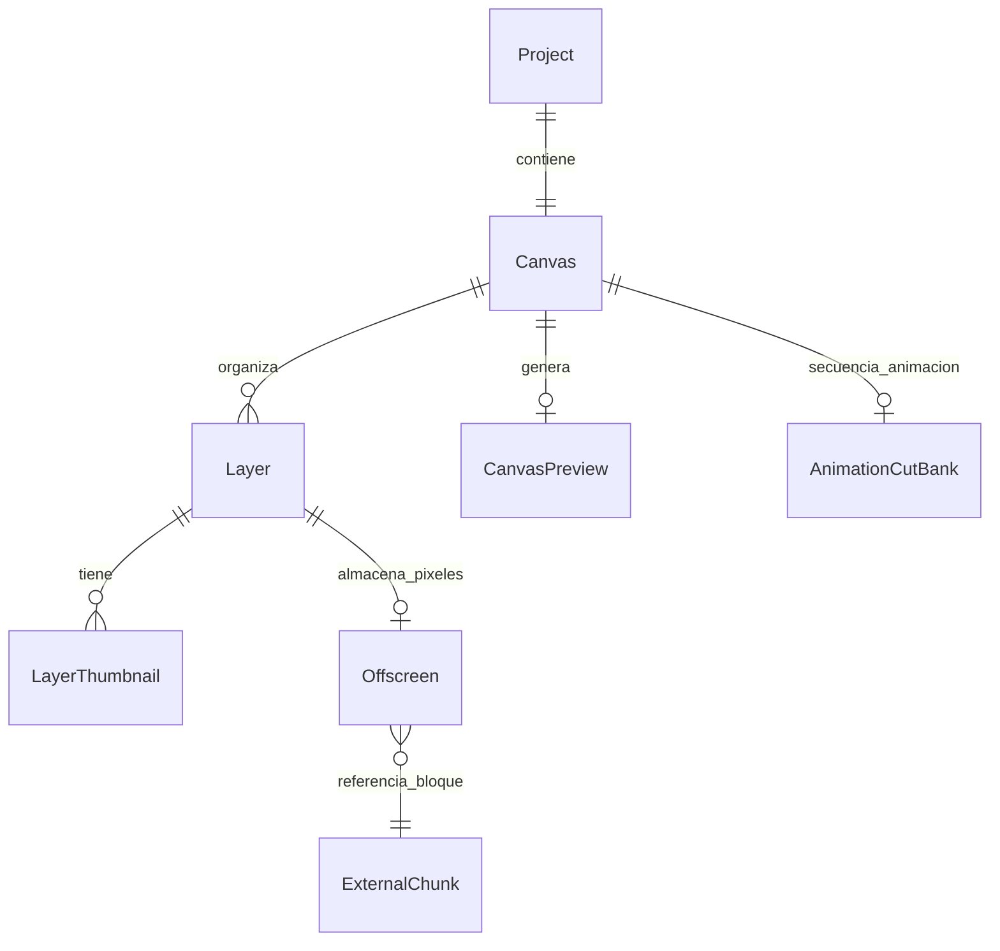
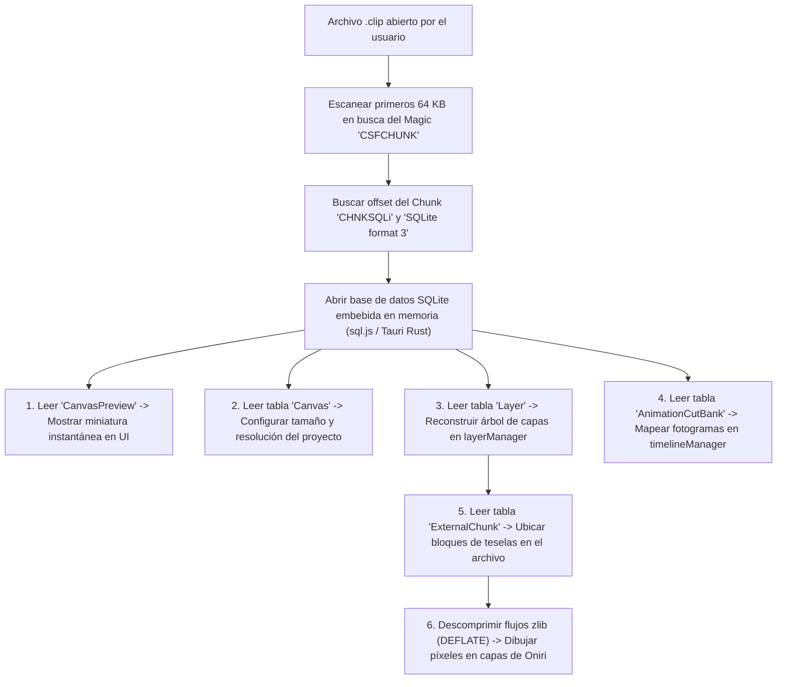

# Estudio de Ingeniería Inversa (REA): Formato de Archivo `.clip` de Clip Studio Paint y Especificación del Sistema de Archivos `.oniri`

Este documento expone los hallazgos técnicos derivados de la inspección binaria y forense de archivos reales de **Clip Studio Paint** (`.clip`), desmontando mitos sobre su supuesta encriptación y estableciendo las bases para:
1. **Crear el sistema de archivos binario nativo de Oniri (`.oniri`)**.
2. **Implementar un importador/lector directo de archivos `.clip` en Oniri**.

---

## 1. Resumen Ejecutivo y Conclusiones Clave

1. **¿Están encriptados los archivos `.clip`?**
   - **NO.** Los archivos `.clip` de ilustraciones y animaciones creados por usuarios **no poseen cifrado criptográfico** (ni AES, ni RSA, ni obfuscación XOR).
   - Utilizan una arquitectura de contenedor por bloques denominada **`CSFCHUNK`** (*Celsys Standard Format Chunk*).
2. **¿Qué contiene un archivo `.clip` en su interior?**
   - Aloja una base de datos estándar **SQLite versión 3** completa e íntegra (`CHNKSQLi`).
   - La imagen de previsualización aplanada del lienzo se almacena directamente como un archivo **PNG estándar** en la tabla `CanvasPreview`.
   - Las capas de dibujo de alta resolución se particionan en teselas (bloques de píxeles) identificadas por un hash (`extrnlid<HASH>`) y comprimidas con **`zlib` (DEFLATE estándar)** en el bloque `CHNKExta`.
   - Las animaciones (cels, tiempos, secuencias y carpetas de animación) se guardan en tablas relacionales (`AnimationCutBank`).

---

## 2. Anatomía del Contenedor Binario `CSFCHUNK`

La estructura binaria del archivo `.clip` sigue un esquema de contenedor de fragmentos ordenados secuencialmente:

```
┌────────────────────────────────────────────────────────────────────────┐
│  ENCABEZADO GLOBAL DEL CONTENEDOR (16 bytes)                          │
│  - Magic: "CSFCHUNK" (8 bytes ASCII: 43 53 46 43 48 55 4E 4B)          │
│  - File Size: uint64 Big-Endian (8 bytes)                              │
├────────────────────────────────────────────────────────────────────────┤
│  CHUNK 1: CHNKHead (Metadatos del Documento y Versión)                 │
│  - Tag: "CHNKHead" (8 bytes)                                           │
│  - Longitud: uint64 Big-Endian                                         │
│  - Carga: Versión de formato, GUID del documento, suite creadora       │
├────────────────────────────────────────────────────────────────────────┤
│  CHUNK 2..N: CHNKExta (External Chunks - Bloques de Píxeles)          │
│  - Tag: "CHNKExta" (8 bytes)                                           │
│  - Longitud: uint64 Big-Endian                                         │
│  - ID Length: uint64 Big-Endian (típicamente 40 bytes)                 │
│  - External ID: "extrnlid<32 hex chars>" (ASCII)                       │
│  - Carga: Bloques UTF-16LE ("BlockDataBeginChunk" ... zlib ... End)    │
├────────────────────────────────────────────────────────────────────────┤
│  CHUNK PRINCIPAL: CHNKSQLi (Base de Datos Relacional SQLite 3)        │
│  - Tag: "CHNKSQLi" (8 bytes: 43 48 4E 4B 53 51 4C 69)                  │
│  - Longitud: uint64 Big-Endian                                         │
│  - Carga: Base de datos SQLite estándar (Magic: "SQLite format 3\0")  │
├────────────────────────────────────────────────────────────────────────┤
│  CHUNK FINAL: CHNKFoot (Verificación de Cierre y Fin de Archivo)       │
│  - Tag: "CHNKFoot" (8 bytes)                                           │
└────────────────────────────────────────────────────────────────────────┘
```

---

## 3. Estructura de la Base de Datos SQLite (`CHNKSQLi`)

Al extraer el bloque `CHNKSQLi`, el motor es SQLite 3 puro, conteniendo las siguientes tablas clave:



### 3.1 Tabla `Canvas`
Define las dimensiones y el perfil del documento:
* `CanvasWidth`: Ancho del lienzo en píxeles (p. ej. `2160.0`).
* `CanvasHeight`: Alto del lienzo en píxeles (p. ej. `2700.0`).
* `CanvasResolution`: Resolución en PPP/DPI (p. ej. `300.0`).
* `CanvasRootFolder`: Puntero al nodo raíz de la jerarquía de capas.

### 3.2 Tabla `Layer`
Registra el árbol de capas, carpetas y propiedades de dibujo:
* `LayerName`: Nombre legible de la capa (p. ej. `'Sketch'`, `'Lineart'`, `'Color'`, `'Paper'`).
* `LayerOpacity`: Opacidad expresada como entero entre $0$ y $256$ ($256 = 100\%$).
* `LayerType`: Tipo de capa:
  * `0`: Carpeta de capas / Grupo.
  * `1`: Capa de píxeles raster estándar.
  * `1584`: Capa de papel de fondo (`Paper`).
* `LayerVisibility`: $1$ visible, $0$ oculta.
* `LayerBlendMode`: Modo de fusión (Normal, Multiplicar, Pantalla, Superponer, etc.).

### 3.3 Tabla `CanvasPreview`
Contiene la miniatura aplanada del lienzo completo:
* `ImageData`: Búfer binario codificado como **PNG nativo** (`89 50 4E 47 0D 0A 1A 0A`).
* Permite a Oniri y al sistema operativo mostrar vistas previas instantáneas de cualquier archivo `.clip` en menos de 10 milisegundos, sin necesidad de procesar ni renderizar ninguna capa.

### 3.4 Tabla `AnimationCutBank`
Define la línea de tiempo de animación:
* Carpetas de animación, pistas de celda, fotogramas clave, repeticiones de cels y velocidad de fotogramas por segundo (FPS).

### 3.5 Tablas `Offscreen` y `ExternalChunk`
* `Offscreen`: Cada capa raster apunta a un identificador `extrnlid<UUID>`.
* `ExternalChunk`: Mapea el identificador externo con el desplazamiento en bytes (`Offset`) exacto dentro del archivo contenedor `CSFCHUNK`.

---

## 4. Almacenamiento y Compresión de Píxeles (`zlib`)

CSP no guarda los píxeles de una capa como un único mapa de bits gigante continuo, sino que los divide en **teselas (tiles)**:
1. Cada bloque de tesela se encapsula entre marcadores binarios `BlockDataBeginChunk` y `BlockDataEndChunk`.
2. Los píxeles RGBA se comprimen utilizando el algoritmo estándar **DEFLATE/zlib** (cabecera `78 9C` o `78 DA`).
3. Al descomprimir el flujo zlib, se obtiene el búfer de píxeles sin comprimir listo para transferirse a un `ImageData` o textura WebGL de HTML5.

---

## 5. Especificación del Formato Binario Propio de Oniri (`.oniri`)

Para Oniri, diseñaremos un sistema de archivos binario de alto rendimiento, optimizado para la web, Tauri v2 y animación 2D en tiempo real.

Existen dos estrategias arquitectónicas excelentes:

### Estrategia A (Recomendada): Paquete Comprimido ZIP / Tar (`.oniri`)
Adoptada por aplicaciones profesionales modernas como Krita (`.kra`), Blender y Procreate:

```
documento.oniri (Contenedor ZIP sin cifrar o DEFLATE nivel 1)
├── mimetype                   ("application/x-oniri")
├── manifest.json              (Metadatos globales, versión de schema, UUID, fecha)
├── preview.png                (Miniatura aplanada 512x512 para previsualización rápida)
├── project.json               (Dimensiones lienzo, FPS, duración, configuración de color)
├── timeline/
│   ├── tracks.json            (Pistas de animación, carpetas, fotogramas clave, cels)
│   └── audio.json             (Pistas de sonido y marcadores)
├── layers/
│   └── hierarchy.json         (Árbol de capas, modos de fusión, opacidad, máscaras)
└── cels/                      (Búferes de píxeles de cada celda de animación)
    ├── cel_001_layer_sketch.webp
    ├── cel_002_layer_sketch.webp
    └── cel_001_layer_color.webp
```

**Ventajas de la Estrategia A para Oniri:**
* **Máxima compatibilidad Web / WASM**: En el navegador y en Tauri, descompresores nativos como `CompressionStream` o bibliotecas como `fflate` / `JSZip` operan en memoria a cientos de MB/s.
* **Formatos de imagen modernos**: Soporte directo de **WebP sin pérdidas** para las celdas, reduciendo el tamaño del archivo entre un $30\%$ y un $50\%$ comparado con PNG y zlib puro de CSP.
* **Inspeccionable y recuperable**: Si un archivo se interrumpe durante el guardado, cualquier descompresor estándar permite recuperar los cels y metadatos intactos.

---

### Estrategia B: Base de Datos SQLite Transaccional (`.oniri-db`)
Similar a CSP `.clip`:

* Archivo único con motor SQLite integrado (a través de `rusqlite` en Rust / Tauri o `sql.js` en WASM).
* **Ventajas**: Guardado transaccional ACID (resistente a apagones o caídas repentinas de energía), guardado incremental ultra-rápido (solo actualiza las teselas modificadas en el último trazo, en lugar de reescribir todo el archivo).

---

## 6. Algoritmo para Importar y Leer Archivos `.clip` en Oniri

Para permitir que Oniri abra y convierta proyectos `.clip`:



### 6.1 Extractor Rápido del Búfer SQLite (TypeScript / Node / Web):
```typescript
export function extractSqliteFromClipBuffer(clipBuffer: Uint8Array): Uint8Array {
  const magic = new TextEncoder().encode("SQLite format 3\0");
  let foundOffset = -1;

  // Búsqueda del marcador SQLite format 3
  for (let i = 0; i <= clipBuffer.length - magic.length; i++) {
    let match = true;
    for (let j = 0; j < magic.length; j++) {
      if (clipBuffer[i + j] !== magic[j]) {
        match = false;
        break;
      }
    }
    if (match) {
      foundOffset = i;
      break;
    }
  }

  if (foundOffset === -1) {
    throw new Error("El archivo no es un documento .clip válido (no contiene CHNKSQLi).");
  }

  // Leer longitud del chunk SQLite (8 bytes anteriores en Big-Endian)
  const view = new DataView(clipBuffer.buffer, clipBuffer.byteOffset, clipBuffer.byteLength);
  const dbLength = Number(view.getBigUint64(foundOffset - 8, false));

  return clipBuffer.subarray(foundOffset, foundOffset + dbLength);
}
```

---

## 7. Plan de Acción para Oniri

1. **Implementar el guardado/exportado nativo `.oniri`**:
   - Crear el módulo [`src/storage/oniriPackage.ts`](file:///d:/Tirando/Oniri/src/storage/oniriPackage.ts) para empaquetar capas, cels de animación, metadatos y miniatura en formato `.oniri`.
2. **Implementar el importador `.clip`**:
   - Integrar un extractor ligero que permita abrir archivos `.clip`, importando directamente sus capas y línea de tiempo dentro de Oniri sin necesidad de exportar a PSD intermedio.
