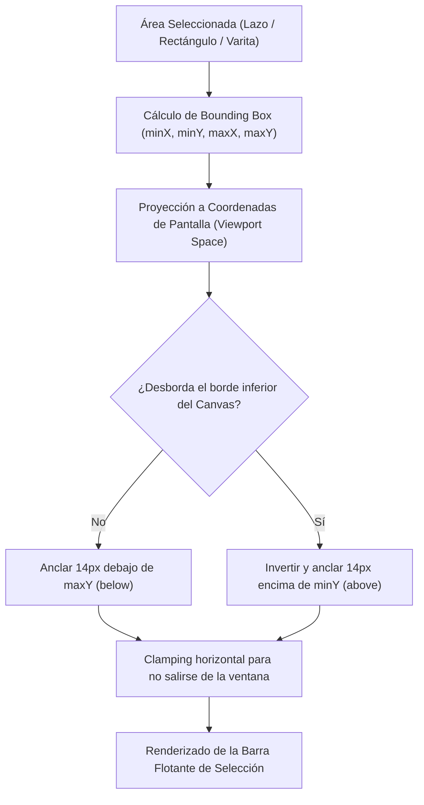

# Estudio de Ingeniería Inversa (REA): Menú Flotante de Selección (Selection Launcher) en Clip Studio Paint (CSP)

Este documento detalla el análisis de ingeniería inversa y estudio funcional del **Menú Flotante de Selección** (*Selection Launcher* / *選択範囲ランチャー*) en **Clip Studio Paint** (CELSYS, Windows x64), su despacho interno de comandos y la especificación de diseño para su implementación completa en **Oniri** (Tauri v2 + Vite + TypeScript + WebGL/Three.js).

---

## 1. Fuentes de Evidencia y Artefactos Analizados

| Artefacto / Archivo | Formato | Hallazgos de Ingeniería Inversa (REA) |
|---|---|---|
| `resource\spanish\742DEA58-ED6B-4402-BC11-20DFC6D08040` | Bundle de recursos binarios de CSP | Cadenas oficiales localizadas: `viewselectlauncher` ("*Mostrar menú flotante de selección*"), `viewselectlaunchersetting` ("*Ajustes del menú flotante de selección*"), `viewtransformlauncher` ("*Mostrar menú flotante de transformación*"). |
| `Settings\PAINT\WorkSpace\Win\spanish\presetWin_1.spws` | Base de datos SQLite 3 | Comandos asociados en `workspaceshortcutmenu`: `selectdeselect` (Ctrl+D), `selectinvert` (Ctrl+Shift+I), `selectexpand`, `selectreduce`, `editclearoutofselectarea` (Alt+Delete), `transformstretch` (Ctrl+T), `pagechangecanvassizetoselectarea`. |
| `Settings\PAINT\WorkSpace\Android\spanish\presetAndroid_1.spws` | Base de datos SQLite 3 | Estructura en `workspacetoolbaritem` del grupo de comandos de selección (categorías 4 y 5): `clear`, `editclearoutofselectarea`, `editpaint`, `transformstretch`, `selectdeselect`, `selectinvert`. |
| `CLIPStudioPaint.exe` & `iswCmnTG.dll` | Binarios Win32 PE64 | Sistema de anclaje flotante vinculado al marco de límites (`bounding box`) del `SelectionMask` con reubicación automática cuando toca bordes de ventana. |

---

## 2. Anatomía y Filosofía de Ergonomía del Menú Flotante

En Clip Studio Paint, el **Menú Flotante de Selección** es un elemento central del flujo de trabajo de entintado, coloreado y maquetación. En lugar de forzar al artista a levantar la pluma de la tableta gráfica para buscar comandos en barras superiores o menús contextuales pesados, el sistema proyecta una cápsula flotante compacta inmediatamente debajo del área que el artista acaba de seleccionar.



---

## 3. Secuencia Canónica de Botones de CSP

A partir del análisis de presets oficiales de CELSYS, la barra flotante cuenta con la siguiente configuración estándar dividida en grupos lógicos por separadores:

```
[ Deseleccionar | Recortar | Invertir ] | [ Expandir | Contraer ] | [ Borrar | Borrar Exterior ] | [ Rellenar | Transformar ] | [ Ajustes ⚙️ ]
```

| N° | Comando CELSYS | Nombre en Interfaz CSP | Atajo | Acción Operativa |
|:---:|---|---|:---:|---|
| **1** | `selectdeselect` | **Deseleccionar** | <kbd>Ctrl + D</kbd> | Limpia la máscara de selección activa y oculta la barra flotante. |
| **2** | `pagechangecanvassizetoselectarea` | **Recortar lienzo a selección** | — | Ajusta las dimensiones del documento al rectángulo delimitador de la selección. |
| **3** | `selectinvert` | **Invertir selección** | <kbd>Ctrl + Shift + I</kbd> | Invierte los píxeles de la máscara en el lienzo de selección. |
| **—** | *Separador* | — | — | Separador visual vertical. |
| **4** | `selectexpand` | **Expandir selección** | — | Dilatación morfológica de la máscara (+1 a +30 px). |
| **5** | `selectreduce` | **Contraer selección** | — | Erosión morfológica de la máscara (-1 a +30 px). |
| **—** | *Separador* | — | — | Separador visual vertical. |
| **6** | `clear` | **Borrar** | <kbd>Delete</kbd> | Limpia los píxeles contenidos dentro de la selección en la capa activa. |
| **7** | `editclearoutofselectarea` | **Borrar fuera de selección** | <kbd>Alt + Delete</kbd> | Limpia los píxeles fuera de la selección en la capa activa. |
| **—** | *Separador* | — | — | Separador visual vertical. |
| **8** | `editpaint` | **Rellenar con color activo** | <kbd>Shift + Delete</kbd> | Rellena el área seleccionada con el color primario de la paleta. |
| **9** | `transformstretch` | **Escalar / Rotar (Transformación)** | <kbd>Ctrl + T</kbd> | Abre el marco modal de transformación libre sobre el contenido seleccionado. |
| **—** | *Separador* | — | — | Separador visual vertical. |
| **10** | `viewselectlaunchersetting` | **Ajustes del menú flotante** | — | Abre el diálogo de configuración para personalizar botones visibles. |

---

## 4. Algoritmos Clave de Implementación

### 4.1 Proyección Dinámica de Coordenadas y Flip Inteligente
El Menú Flotante debe seguir suavemente la selección incluso cuando el usuario hace paneo (<kbd>Espacio</kbd>), zoom (<kbd>Ctrl+Espacio</kbd>) o rotación de lienzo (<kbd>R</kbd>).

1. Proyectar `(centerX, maxY)` mediante la matriz de cámara Three.js `projVec.project(camera)` a coordenadas cliente de pantalla.
2. Si `below.y + margin + barHeight > innerHeight - edgePadding`, invertir la posición vertical calculando `above.y - margin - barHeight`.
3. Limitar horizontalmente `left = clamp(margin + barWidth/2, innerWidth - margin - barWidth/2, centerX)`.

### 4.2 Dilatación y Erosión Morfológica de Máscaras (Expand / Contract)
En CSP, expandir o contraer una selección de forma arbitraria se procesa a nivel de mapa de bits (máscara de 1 canal o alfa):
- **Expandir (+r)**: Por cada píxel activo, se dibuja un trazo o kernel circular de radio `r` (dilatación).
- **Contraer (-r)**: Se invierte la máscara temporalmente, se expande por `r` píxeles, y se vuelve a invertir (dualidad de De Morgan / erosión matemática).

---

## 5. Integración en el Stack de Oniri

1. **`src/selection/selectionModel.ts`**:
   - Incorporar `expandSelection(radiusPx: number): void`.
   - Incorporar `contractSelection(radiusPx: number): void`.
2. **`src/selection/selectionLauncher.ts`**:
   - Reemplazar la barra mínima actual con la suite completa de 10 acciones canónicas de CSP.
   - Diálogos emergentes (*popovers*) rápidos para entrada de radio en píxeles al expandir o contraer.
   - Botón de engranaje ⚙️ (*Ajustes del menú flotante*) con almacenamiento persistente en `localStorage`.
   - Soporte para visibilidad global (`view.selectLauncher`) activable desde el menú superior **Ver > Menú flotante de selección**.
3. **`src/ui/defaultMenuConfig.ts`**:
   - Registro de `view.selectLauncher` y `view.selectLauncherSettings`.
   - Entradas en el menú desplegable **Ver** y menú **Selección**.
