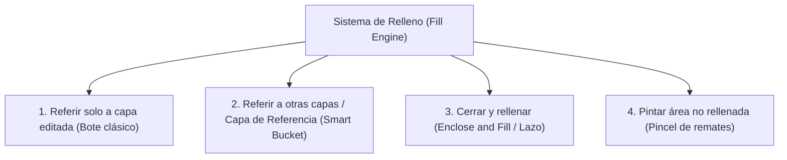
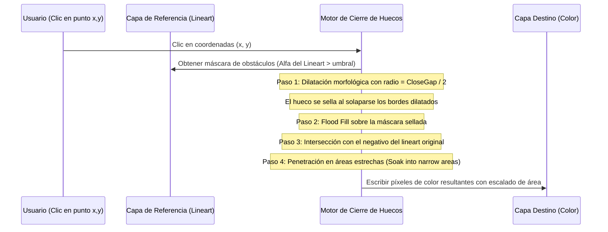

# Estudio de Ingeniería Inversa (REA): Sistema de Relleno Inteligente y Capas de Referencia en Clip Studio Paint (CSP)

Este informe documenta la investigación técnica realizada mediante inspección de bases de datos de herramientas (`EditImageTool.todb`), esquemas de parámetros (`Variant`) y recursos lingüísticos de **Clip Studio Paint** (CELSYS), detallando la matemática y algoritmos del sistema de coloreado más eficiente de la industria de la animación y su implementación en **Oniri**.

---

## 1. Fuentes y Evidencia Extraída de CSP

| Archivo / Base de Datos | Ubicación | Datos extraídos |
|---|---|---|
| `EditImageTool.todb` | `Settings\PAINT\Tool\spanish` | Esquema de herramientas: nodos de relleno y parámetros exactos de la tabla `Variant`. |
| Bundle Lingüístico `E79C2AC5-...` | `resource\spanish` | Textos oficiales, nombres de parámetros y explicaciones técnicas de los algoritmos de Celsys. |
| `iswCoreTG.dll` | Binario PE64 | Motor de rasterizado y operaciones morfológicas de píxeles (`Fill`, `Expand`, `Mask`). |

---

## 2. Las 4 Herramientas Maestras de Relleno en CSP

De la tabla `Node` de la base de datos de CSP, se extraen las cuatro variantes del sistema de relleno:



1. **Referir solo a capa editada**: Bote de pintura tradicional que evalúa y pinta sobre la misma capa activa.
2. **Referir a otras capas (Capa de Referencia)**: Permite que el lineart esté en una capa superior (etiquetada como *Referencia*) y la pintura se deposite en la capa activa (*Color*), cerrando huecos y expandiendo el color bajo la línea sin destruirla.
3. **Cerrar y rellenar (Enclose and Fill)**: El usuario traza un lazo rápido alrededor del personaje; el algoritmo identifica automáticamente todas las áreas cerradas interiores transparentes y las rellena de una sola vez, ignorando el lienzo exterior.
4. **Pintar área no rellenada**: Un pincel de relleno que solo aplica color a los pequeños huecos y esquinas que hayan quedado sin pintar.

---

## 3. Matriz de Parámetros Reales Extraídos de la Base de Datos

Valores predeterminados reales leídos de la tabla `Variant` para cada herramienta de relleno:

| Parámetro en Base de Datos | Referir solo editada | Referir a otras capas | Cerrar y rellenar | Pintar no rellenada | Función Técnica |
|---|:---:|:---:|:---:|:---:|---|
| `FillReferMultiLayer` | `0` | `1` | `1` | `1` | Consulta múltiples capas para calcular el límite. |
| `FillReferLayerType` | `0` | `0` | `0` | `0` | Modo de referencia (`0`: Todas las capas / Capa de Referencia). |
| `FillNotReferDraft` | `1` | `1` | `1` | `1` | Ignora capas marcadas como boceto/guía (*Draft*). |
| `FillNotReferPaper` | `1` | `1` | `1` | `1` | Ignora la capa de fondo de papel blanco. |
| `FillUseCloseGap` | `1` | `1` | `1` | `0` | Activa el algoritmo para evitar desbordamientos por huecos. |
| `FillCloseGap` | `2.0` | `2.0` | `2.0` | `2.0` | Umbral de tamaño de hueco a cerrar (en píxeles o nivel 1-5). |
| `FillSoakIntoNarrowArea` | `1` | `1` | `1` | `1` | **Penetrar en áreas estrechas**: obliga al color a llegar a picos afilados. |
| `FillUseExpand` | `0` | `1` | `1` | `0` | **Escalado de área**: expande el relleno bajo el trazo. |
| `FillExpandLength` | `10.0` | `10.0` | `10.0` | `10.0` | Distancia de expansión (en píxeles o porcentaje). |
| `FillExpandType` | `2` | `2` | `2` | `2` | Tipo de expansión (`1`: Rectángulo, `2`: Redondo, `3`: Al más oscuro). |
| `FillColorMargin` | `10.0` | `10.0` | `30.0` | `80.0` | Tolerancia de color respecto al píxel de clic ($0-100$). |
| `FillContinuousPixel` | `1` | `1` | `null` | `null` | Si es `1`, solo rellena píxeles contiguos conectados. |
| `CloseFillReferColorType`| `null` | `null` | `7` | `7` | Filtro de color objetivo (`7` = únicamente zonas transparentes). |

---

## 4. Algoritmos y Fundamentos Matemáticos

### 4.1 El Problema del "Halo Blanco" y el Escalado de Área (`FillUseExpand`)

Cuando un artista dibuja una línea digital, los bordes contienen **anti-aliasing** (píxeles semitransparentes en degradado hacia la transparencia). 
Un algoritmo de *flood fill* normal se detiene ante el primer píxel semitransparente, dejando una línea blanca vacía entre la tinta y el color:

```
Tinta Ocupada (Alfa 1.0) ──►  [████████]  (Línea negra)
Anti-aliasing (Alfa 0.4) ──►  [▒▒▒▒▒▒▒▒]  <── Flood fill normal se detiene aquí
Fondo Vacío (Alfa 0.0)   ──►  [        ]  <── Queda un HALO BLANCO
```

#### Solución de CSP: Expansión Morfológica (`FillExpandLength` & `FillExpandType` = `2` Redondo)
1. Se calcula la máscara binaria del área inundada $M_0$.
2. Se aplica una dilatación morfológica euclidiana con radio $r = \text{FillExpandLength}$:
   $$M_{\text{expanded}} = M_0 \oplus B_r$$
   Donde $B_r$ es un disco estructurante circular:
   $$B_r = \{ (x, y) \in \mathbb{Z}^2 : x^2 + y^2 \le r^2 \}$$
3. Como la capa de **Color** se ubica **por debajo** de la capa de **Lineart**, el color expandido se desliza por debajo del trazo negro, eliminando los bordes blancos con precisión de subpíxel.

---

### 4.2 Algoritmo de Cierre de Huecos (`FillUseCloseGap`)

Para evitar que la pintura se desborde si el trazo tiene una fisura de varios píxeles:



1. **Detección de Obstáculos**: Se genera una máscara booleana $L(x, y)$ donde $1$ representa tinta y $0$ espacio vacío.
2. **Sellado Morfológico**:
   $$L_{\text{closed}} = L \oplus B_{r_{\text{gap}}}$$
   Cualquier abertura con separación menor o igual a $2 \cdot r_{\text{gap}}$ queda físicamente cerrada en $L_{\text{closed}}$.
3. **Inundación Acotada**: Se ejecuta el flood fill desde $(x_0, y_0)$ sobre la cuadrícula $L_{\text{closed}}$. El color no puede escapar por la grieta sellada.
4. **Reconstrucción de Silueta**: Para que el color llegue hasta el borde real del dibujo y no se quede separado por la dilatación, la región inundada se proyecta sobre el inverso del lineart real:
   $$R_{\text{fill}} = R_{\text{flooded}} \cap \neg L$$

---

### 4.3 Algoritmo "Cerrar y Rellenar" (Lazo de Relleno / Enclose and Fill)

Permite colorear figuras complejas dibujando un lazo exterior:
1. El usuario dibuja un lazo cerrado poligonal o libre $P$.
2. Se extrae el cuadro delimitador (*bounding box*) de $P$.
3. Se analizan las componentes conexas de píxeles transparentes dentro de $P$:
   - Toda componente que toque el perímetro exterior del lazo sin estar contenida por líneas de la capa de referencia se clasifica como **Exterior** y se descarta.
   - Toda componente conexa que esté completamente circundada por líneas de la capa de referencia se clasifica como **Interior** y se rellena inmediatamente.

---

## 5. Implementación del Motor en Oniri (`src/brush/smartFill.ts`)

A continuación se define la implementación optimizada para el motor de Oniri:

```typescript
export interface SmartFillOptions {
  seedX: number;
  seedY: number;
  fillColor: string; // Hexadecimal '#rrggbb' o rgba
  tolerance: number; // 0 - 255
  closeGap: number; // Radio de cierre de huecos (0 = desactivado, 1-10 px)
  expand: number; // Escalado de área en píxeles (0-10 px)
  soakNarrow: boolean; // Penetrar en esquinas afiladas
  referenceCtx?: CanvasRenderingContext2D | null; // Capa de referencia (Lineart)
  targetCtx: CanvasRenderingContext2D; // Capa activa donde se deposita el color
  width: number;
  height: number;
}

export function executeSmartFill(options: SmartFillOptions): void {
  const { seedX, seedY, fillColor, tolerance, closeGap, expand, referenceCtx, targetCtx, width, height } = options;

  // 1. Obtener datos de píxeles
  const targetImg = targetCtx.getImageData(0, 0, width, height);
  const targetData = targetImg.data;
  
  // Si hay capa de referencia, los límites se leen de ella; de lo contrario, de la capa actual
  const boundaryData = referenceCtx ? referenceCtx.getImageData(0, 0, width, height).data : targetData;

  const totalPixels = width * height;
  const visited = new Uint8Array(totalPixels);
  const fillMask = new Uint8Array(totalPixels);

  // 2. Comprobación del píxel semilla
  const seedIdx = seedY * width + seedX;
  if (boundaryData[seedIdx * 4 + 3] > 200) {
    // Si se hizo clic directamente sobre la línea de tinta, no hacer nada
    return;
  }

  // 3. Crear máscara de obstáculos con Cierre de Huecos (Morphological Dilation)
  const obstacleMask = new Uint8Array(totalPixels);
  for (let i = 0; i < totalPixels; i++) {
    // Es obstáculo si la opacidad supera el umbral de tolerancia
    obstacleMask[i] = boundaryData[i * 4 + 3] > tolerance ? 1 : 0;
  }

  const effectiveObstacles = closeGap > 0 ? dilateBinaryMask(obstacleMask, width, height, closeGap) : obstacleMask;

  // 4. Flood Fill por líneas de escaneo (Scanline Flood Fill) sobre la máscara acotada
  const queue: [number, number][] = [[seedX, seedY]];
  visited[seedIdx] = 1;

  while (queue.length > 0) {
    const [cx, cy] = queue.pop()!;
    let lx = cx;
    while (lx > 0 && effectiveObstacles[cy * width + (lx - 1)] === 0 && visited[cy * width + (lx - 1)] === 0) {
      lx--;
    }
    let rx = cx;
    while (rx < width - 1 && effectiveObstacles[cy * width + (rx + 1)] === 0 && visited[cy * width + (rx + 1)] === 0) {
      rx++;
    }

    for (let x = lx; x <= rx; x++) {
      const idx = cy * width + x;
      visited[idx] = 1;
      fillMask[idx] = 1;

      // Escanear filas adyacentes superior e inferior
      if (cy > 0) {
        const topIdx = (cy - 1) * width + x;
        if (effectiveObstacles[topIdx] === 0 && visited[topIdx] === 0) {
          queue.push([x, cy - 1]);
        }
      }
      if (cy < height - 1) {
        const botIdx = (cy + 1) * width + x;
        if (effectiveObstacles[botIdx] === 0 && visited[botIdx] === 0) {
          queue.push([x, cy + 1]);
        }
      }
    }
  }

  // 5. Escalado de Área (Dilatación final para meter el color bajo la línea)
  const finalMask = expand > 0 ? dilateBinaryMask(fillMask, width, height, expand) : fillMask;

  // 6. Volcar el color en el Canvas de destino
  const [r, g, b, a] = parseColor(fillColor);
  for (let i = 0; i < totalPixels; i++) {
    if (finalMask[i] === 1) {
      const p = i * 4;
      targetData[p] = r;
      targetData[p + 1] = g;
      targetData[p + 2] = b;
      targetData[p + 3] = a;
    }
  }

  targetCtx.putImageData(targetImg, 0, 0);
}

/** Dilatación morfológica binaria rápida por separación de ejes o radio euclidiano */
function dilateBinaryMask(src: Uint8Array, w: number, h: number, radius: number): Uint8Array {
  const dst = new Uint8Array(src.length);
  const r2 = radius * radius;

  for (let y = 0; y < h; y++) {
    for (let x = 0; x < w; x++) {
      if (src[y * w + x] === 1) {
        for (let dy = -radius; dy <= radius; dy++) {
          const ny = y + dy;
          if (ny < 0 || ny >= h) continue;
          for (let dx = -radius; dx <= radius; dx++) {
            const nx = x + dx;
            if (nx < 0 || nx >= w) continue;
            if (dx * dx + dy * dy <= r2) {
              dst[ny * w + nx] = 1;
            }
          }
        }
      }
    }
  }
  return dst;
}

function parseColor(hex: string): [number, number, number, number] {
  let c = hex.replace('#', '');
  if (c.length === 6) c += 'ff';
  const num = parseInt(c, 16);
  return [(num >> 24) & 255, (num >> 16) & 255, (num >> 8) & 255, num & 255];
}
```

---

## 6. Plan de Integración en la Interfaz de Oniri

1. **Soporte de Capa de Referencia en el Panel de Capas (`layersView.ts`)**:
   - Añadir el icono del faro / estrella de "Capa de Referencia" en cada capa.
   - Al activar el faro en la capa de *Lineart*, queda registrada como `referenceLayerId`.
2. **Propiedades de la Herramienta Bote en la Barra Lateral (`toolsView.ts`)**:
   - **Tolerancia**: Slider $0 - 100$.
   - **Cerrar hueco**: Toggle + Slider de $1$ a $10\text{ px}$.
   - **Escalado de área**: Toggle + Slider de $1$ a $5\text{ px}$ (para eliminar bordes blancos).
   - **Origen de referencia**: Toggle entre *Capa activa* y *Capa de referencia*.
3. **Subherramienta "Cerrar y Rellenar"**:
   - Añadir la subherramienta de lazo de relleno en la paleta de botes de pintura de la barra izquierda.
