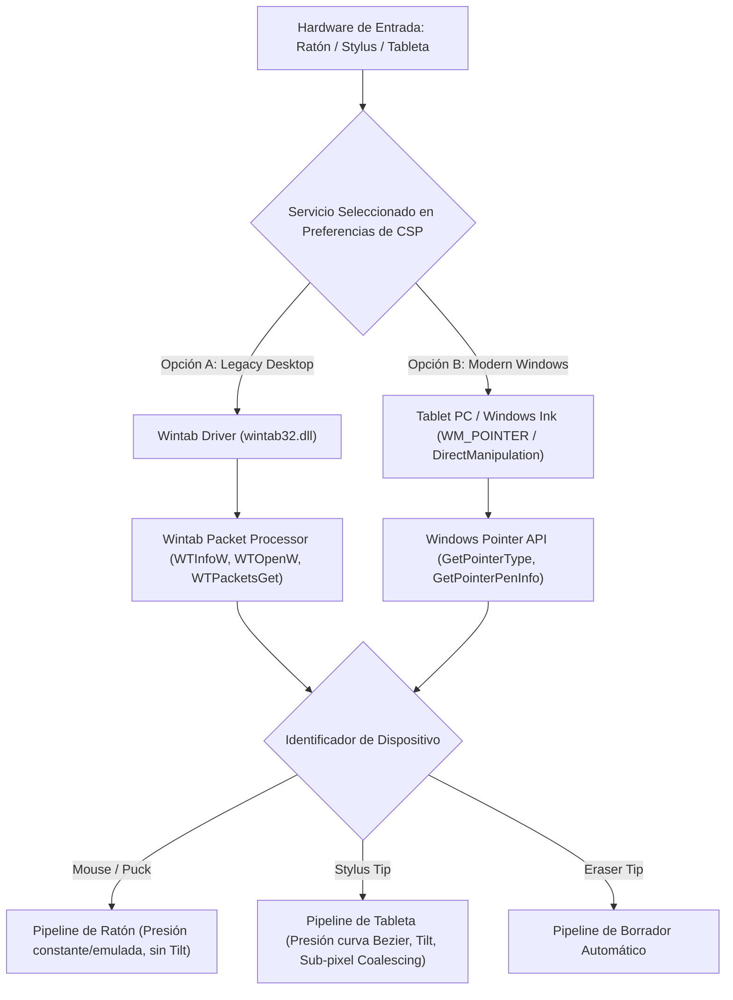

# Estudio de Ingeniería Inversa (REA): Sistema de Reconocimiento de Ratón y Tabletas Digitalizadoras en Clip Studio Paint (CSP)

Este documento detalla la investigación técnica sobre cómo **Clip Studio Paint** (CELSYS, Windows x64) identifica, diferencia y procesa los eventos procedentes del ratón, lápices ópticos (stylus) y tabletas digitalizadoras, así como su modelo de réplica óptimo para la arquitectura web/Tauri de **Oniri**.

---

## 1. Fuentes y Evidencia de Artefactos Analizados

| Componente / Archivo | Subsistema | Función analizada |
|---|---|---|
| `CLIPStudioPaint.exe` | Win32 PE64 | Bucle de mensajes principal, captura de eventos (`PointerCapture`) y gestión de dispositivos de entrada. |
| `triglavwinrt.dll` | WinRT Component | Integración con APIs modernas de Windows (Windows Ink, Pointer Input, Surface Dial / `RadialController`). |
| `iswCoreTG.dll` | C++ Core Graphics Engine | Procesamiento matemático de trazos, curvas de presión y dinámicas de pincel. |
| Preferencias CSP (`Preference`) | SQLite / Registry | Ajustes de servicio de tableta: selección entre **Wintab** y **Tablet PC**, detección de coordenadas y submuestreo. |

---

## 2. Arquitectura Dual de Controladores en CSP

En el menú **Archivo > Preferencias > Tableta**, Clip Studio Paint implementa una arquitectura desacoplada de dos capas para interactuar con el hardware de digitalización:



---

## 3. Identificación a Nivel de Sistema Operativo

### 3.1 Modo Wintab (`wintab32.dll`)
Utilizado históricamente por tabletas profesionales (Wacom, Huion, XP-Pen) con controladores nativos:

1. **Apertura de Contexto**:
   - CSP realiza `LoadLibraryW("wintab32.dll")` y consulta las capacidades del dispositivo con `WTInfoW(WTI_DEVICES, ...)`.
   - Inicializa el contexto lógico con `WTOpenW(hWnd, &logContext, TRUE)`.
2. **Discriminación del Cursor**:
   - Al recibir paquetes de tableta (`WT_PACKET`), consulta el cursor activo mediante:
     $$\text{WTInfoW}(WTI\_CURSORS + i, CSR\_TYPE, \&cursorType)$$
   - Los valores de retorno determinan el dispositivo:
     - `CSR_TYPE_PUCK` (`0x0002`): Ratón de tableta o ratón emulado.
     - `CSR_TYPE_STYLUS` (`0x0822`): Punta del lápiz digitalizador.
     - `CSR_TYPE_ERASER` (`0x082a`): Extremo opuesto del lápiz (goma de borrar física).
3. **Captura de Magnitudes Físicas**:
   - Presión normal: `pkNormalPressure` (enteros entre $0$ y $1024, 2048, 4096$ o $8192$ según el hardware).
   - Inclinación: `pkOrientation.orAltitude` (ángulo respecto al plano) y `pkOrientation.orAzimuth` (ángulo horizontal).
   - Rotación del cilindro: `pkOrientation.orTwist` ($0^\circ$ a $360^\circ$).

---

### 3.2 Modo Tablet PC / Windows Ink (`WM_POINTER` y WinRT)
Utilizado en pantallas táctiles modernas, portátiles convertibles 2-en-1 (Surface Pro) y tabletas con Windows Ink:

1. **Registro de la Ventana**:
   - La ventana principal habilita la coexistencia mediante `EnableMouseInPointer(TRUE)` y captura de mensajes de puntero:
     - `WM_POINTERDOWN` (`0x0246`)
     - `WM_POINTERUPDATE` (`0x0245`)
     - `WM_POINTERUP` (`0x0247`)
2. **Determinación del Tipo de Dispositivo**:
   - En cada mensaje, CSP extrae el identificador del puntero (`GET_POINTERID_WPARAM(wParam)`) e invoca:
     $$\text{GetPointerType}(pointerId, \&pointerType)$$
   - Clasificación:
     - `PT_MOUSE` ($1$): Ratón tradicional o trackpad.
     - `PT_TOUCH` ($2$): Contacto capacitivo del dedo (gestos táctiles multitouch).
     - `PT_PEN` ($3$): Lápiz digitalizador activo.
     - `PT_TOUCHPAD` ($4$): Panel táctil de precisión.
3. **Inspección de Datos Específicos del Lápiz**:
   - Cuando el tipo es `PT_PEN`, se ejecuta `GetPointerPenInfo(pointerId, &penInfo)`:
     - `penInfo.penFlags & PEN_FLAG_BARREL`: Botón lateral o botón secundario del lápiz presionado.
     - `penInfo.penFlags & PEN_FLAG_INVERTED`: Lápiz invertido físicamente sobre la pantalla.
     - `penInfo.penFlags & PEN_FLAG_ERASER`: Extremo de borrado en contacto.
     - `penInfo.pressure`: Presión normalizada ($0$ a $1024$).
     - `penInfo.tiltX`, `penInfo.tiltY`: Inclinación en grados ($-90^\circ$ a $+90^\circ$).
     - `penInfo.rotation`: Giro angular del lápiz.

---

## 4. Diferencias de Comportamiento: Ratón vs. Tableta en CSP

| Característica | Ratón (`PT_MOUSE` / `CSR_TYPE_PUCK`) | Tableta / Stylus (`PT_PEN` / `CSR_TYPE_STYLUS`) |
|---|---|---|
| **Presión** | Desactivada o fija a $1.0$. Si el pincel tiene dinámica de velocidad, la presión se estima por rapidez del cursor. | Activa y granular ($0.0$ a $1.0$ escalado por la curva de presión Bezier configurada en preferencias). |
| **Inclinación (Tilt)** | Siempre $0^\circ$ (desactivada). | Activa (`tiltX`, `tiltY`). Modifica el ángulo y grosor de la huella del pincel (huellas elípticas). |
| **Frecuencia de Muestreo** | $60\text{ Hz} - 120\text{ Hz}$ (ligada a la tasa de refresco del SO o ratón estándar). | $200\text{ Hz} - 500\text{ Hz}$ (paquetes subpíxel acumulados entre cuadros de renderizado). |
| **Comportamiento del Clic Secundario** | Abre menú contextual o activa herramienta Cuentagotas. | Botón de barril programable (desplazamiento de lienzo, cuentagotas o alternancia de herramienta). |
| **Detección de Borrador** | No aplica. | Al tocar con el extremo invertido (`PEN_FLAG_ERASER`), conmuta temporalmente a la goma sin alterar la subherramienta activa. |

---

## 5. Implementación en Oniri (Tauri v2 + WebView2 / W3C Pointer Events)

Debido a que **Oniri** corre sobre Tauri v2 con WebView2 (Chromium en Windows), el motor de Chromium ya traduce internamente los mensajes nativos del sistema operativo (`WM_POINTER` y Windows Ink) al estándar W3C **`PointerEvent`**.

### 5.1 Tabla de Correspondencias para Oniri

```
Clip Studio Paint (Win32 / WinRT)      ──►  Oniri (W3C Pointer Events)
─────────────────────────────────────────────────────────────────────────────
GetPointerType == PT_MOUSE             ──►  event.pointerType === 'mouse'
GetPointerType == PT_PEN               ──►  event.pointerType === 'pen'
GetPointerType == PT_TOUCH             ──►  event.pointerType === 'touch'
penInfo.pressure                       ──►  event.pressure (float 0.0 a 1.0)
penInfo.tiltX, tiltY                   ──►  event.tiltX, event.tiltY (grados -90 a +90)
penInfo.rotation                       ──►  event.twist (grados 0 a 359)
penInfo.penFlags & PEN_FLAG_ERASER     ──►  event.buttons === 32 || event.button === 5
GetPointerInfoHistory(...)             ──►  event.getCoalescedEvents()
GetPointerFramePenInfoHistory(...)     ──►  event.getPredictedEvents()
```

---

### 5.2 Muestreo de Alta Frecuencia (Sub-Pixel Coalescing)
Las tabletas digitalizadoras emiten coordenadas a más de $200\text{ Hz}$, pero el navegador ejecuta el bucle de renderizado a $60\text{ Hz}$ o $120\text{ Hz}$. 
Si solo se escucha el evento directo `pointermove`, se pierde el $70\%$ de los puntos intermedios, provocando trazos poligonales o esquinas rotas:

```typescript
// Implementado en Oniri (src/brush/strokeInput.ts):
function coalescedSamples(event: PointerEvent): PointerEvent[] {
  const fn = (event as PointerEvent & { getCoalescedEvents?: () => PointerEvent[] }).getCoalescedEvents;
  if (typeof fn !== 'function') return [event];
  try {
    const list = fn.call(event);
    return list && list.length > 0 ? list : [event];
  } catch {
    return [event];
  }
}
```

---

### 5.3 Curva de Calibración de Presión de CSP
En CSP, la presión física directa rara vez se aplica de manera lineal. Se aplica una función de transferencia de respuesta:

$$p_{\text{efectiva}} = f(p_{\text{raw}})$$

Para reproducir la curva de ajuste de CSP en Oniri:

```typescript
export interface PressureCurveSettings {
  /** 
   * Modo: 'linear' (recta), 'soft' (mayor facilidad para trazos gruesos),
   * 'hard' (requiere mayor fuerza para grosor máximo), 'bezier' (curva personalizada)
   */
  mode: 'linear' | 'soft' | 'hard' | 'custom';
  gamma: number; // Por defecto 1.0. Soft: 0.6 - 0.8. Hard: 1.3 - 1.6.
}

export function evaluatePressure(rawPressure: number, settings: PressureCurveSettings): number {
  if (rawPressure <= 0.001) return 0.0;
  if (rawPressure >= 0.999) return 1.0;

  // Curva exponencial gamma (aproximación continua de la curva de CSP)
  const clamped = Math.max(0, Math.min(1, rawPressure));
  return Math.pow(clamped, settings.gamma);
}
```

---

### 5.4 Detección Automática de Punta de Borrado Físico (Eraser)
Al igual que en CSP, cuando un lápiz óptico entra en contacto con la pantalla usando su extremo trasero o borrador integrado:

```typescript
function isPhysicalEraser(event: PointerEvent): boolean {
  // W3C Pointer Events: el bit 5 (máscara 32) indica el botón de borrado
  return event.pointerType === 'pen' && (event.buttons === 32 || event.button === 5);
}
```

Al detectar `isPhysicalEraser(event) === true`, Oniri conmuta el renderizado del trazo a modo composición `'destination-out'` (borrador) o selecciona internamente el sub-motor de borrado sin cambiar visualmente la herramienta activa de la barra lateral, restaurando el pincel en cuanto el usuario retira el lápiz.

---

## 6. Conclusiones y Próximos Pasos en el Código de Oniri

1. **`src/brush/strokeInput.ts`**:
   - Ya implementa la diferenciación primaria `lastPointerType !== 'pen'` para fijar presión a $1.0$ en ratón y recuperar la presión analógica en lápices.
   - Ya procesa `event.getCoalescedEvents()` para retener la suavidad de las tabletas de alta frecuencia.
2. **Extensiones planificadas en Oniri**:
   - **Curva de presión de usuario**: Añadir en las propiedades de herramientas (`toolState.ts`) el ajuste de sensibilidad/dureza de tableta (Gamma/Bézier).
   - **Soporte de Inclinación (`tiltX`, `tiltY`)**: Integrar la rotación y estiramiento de la huella del pincel en [`src/brush/brushEngine.ts`](file:///d:/Tirando/Oniri/src/brush/brushEngine.ts) para simular lápices de dibujo inclinados (estilo carboncillo/grafito de CSP).
   - **Alternancia automática de goma física**: Activar el borrado al detectar la máscara de botón $32$ de lápiz.
