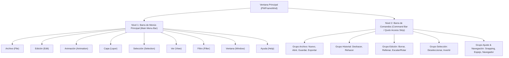
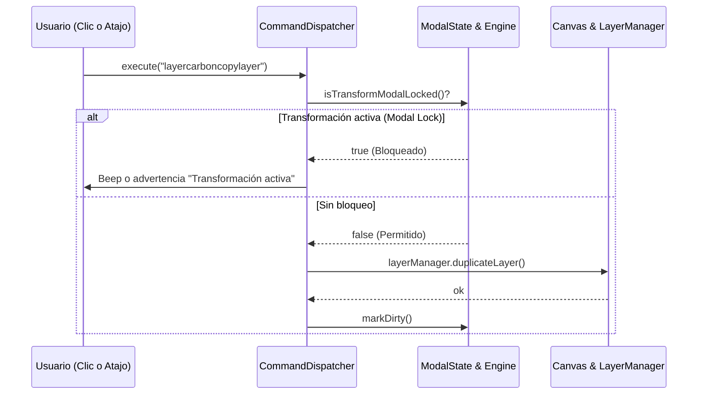

# Estudio de Ingeniería Inversa (REA): Sistema de UI Superior (Menús, Comandos y Modos) en Clip Studio Paint (CSP)

Este documento detalla la investigación técnica realizada mediante ingeniería inversa y análisis de artefactos sobre el subsistema de interfaz de usuario superior de **Clip Studio Paint** (CELSYS, Windows x64), abarcando la **Barra de Menús Principal (Menu Bar)**, la **Barra de Comandos (Command Bar)**, el despacho centralizado de acciones y su adaptación arquitectónica para el stack de **Oniri** (Tauri v2 + Vite + TypeScript + WebGL/Three.js).

---

## 1. Fuentes de Evidencia y Artefactos Analizados

| Artefacto / Archivo | Tipo / Formato | Hallazgos Clave de Ingeniería Inversa |
|---|---|---|
| `CLIPStudioPaint.exe` | Binario PE64 Win32 | Clase de ventana principal `PWFrameWnd`, contenedores `PWDockContainer`, `PWDock`, `PWBooth`, y captura de eventos modales. |
| `Settings\PAINT\WorkSpace\Win\spanish\presetWin_1.spws` | Base de datos SQLite 3 | Tablas `workspaceshortcutmenu` (606 comandos y atajos nativos) y `workspacetoolbaritem` (iconos y orden de la barra de comandos). |
| `resource\spanish\742DEA58-ED6B-4402-BC11-20DFC6D08040` | Bundle de recursos binarios | Cadenas de localización en español oficial para menús, diálogos, atajos y estados contextuales. |
| `iswCmnTG.dll` | Biblioteca dinámica C++ | Implementación interna de despacho de comandos de documento (`advancedcommand`, `basiccommand`, `toolcommand`). |

---

## 2. Anatomía de la Interfaz Superior en Clip Studio Paint

En Clip Studio Paint, la zona superior de la pantalla no es un encabezado estático monolítico, sino una **estructura modular de dos niveles jerárquicos** perfectamente diferenciados:



---

## 3. Taxonomía de los 9 Menús Canónicos de CSP

A partir del volcado de la tabla `workspaceshortcutmenu` de `presetWin_1.spws`, se documenta el árbol completo de categorías, identificadores internos de CELSYS y atajos de teclado estándar:

### 3.1 Menú "Archivo" (File)
Controla el ciclo de vida del documento, importación, exportación y preferencias globales:
- `filenew` (<kbd>Ctrl + N</kbd>): Crea un nuevo lienzo con configuración de dimensiones, resolución y tipo (Ilustración / Animación).
- `filenewfromclipboard`: Crea lienzo a partir de una imagen en el portapapeles del sistema.
- `fileopen` (<kbd>Ctrl + O</kbd>): Abre archivos nativos (`.clip`, `.oniri`) o imágenes rasterizadas.
- `fileclose` (<kbd>Ctrl + W</kbd>): Cierra el documento activo solicitando confirmación si hay cambios pendientes.
- `filesave` (<kbd>Ctrl + S</kbd>): Guarda el archivo en el disco sin desplegar diálogo si ya tiene ruta.
- `filesaveas` (<kbd>Ctrl + Shift + S</kbd>): Guardar como nuevo archivo o formato.
- `filesavemergeimagepng` / `filesavemergeimagejpg`: Exportación aplanada rápida.
- `exportanimationgif` / `exportmovie` / `exportimageseries`: Exportación de la animación a GIF89a, MP4 o secuencia numerada de PNGs.
- `fileimportimage` / `fileimportmovie`: Importación de assets externos a una capa nueva.
- `applicationpreference` (<kbd>Ctrl + K</kbd>): Abre el modal de configuración general (Tableta, Rendimiento, Interfaz).
- `applicationquit` (<kbd>Ctrl + Q</kbd> / <kbd>Alt + F4</kbd>): Salida de la aplicación.

### 3.2 Menú "Edición" (Edit)
Operaciones sobre el búfer del documento, portapapeles y transformaciones de raster:
- `undo` (<kbd>Ctrl + Z</kbd>): Deshacer la última acción del historial.
- `redo` (<kbd>Ctrl + Y</kbd> o <kbd>Ctrl + Shift + Z</kbd>): Rehacer la última acción deshecha.
- `cut` (<kbd>Ctrl + X</kbd>) / `copy` (<kbd>Ctrl + C</kbd>) / `paste` (<kbd>Ctrl + V</kbd>): Manejo del portapapeles.
- `clear` (<kbd>Delete</kbd> / <kbd>Backspace</kbd>): Borra los píxeles dentro de la selección o de toda la capa activa.
- `editclearoutofselectarea` (<kbd>Alt + Delete</kbd>): Borra todo lo que queda fuera de la selección activa.
- `editpaint` (<kbd>Shift + Delete</kbd> / <kbd>Alt + Delete</kbd>): Rellena la selección con el color primario activo.
- `transformstretch` (<kbd>Ctrl + T</kbd>): Inicia el modo modal de Escalar/Rotar con gizmo delimitador.
- `transformfree` (<kbd>Ctrl + Shift + T</kbd>): Transformación libre con 4 esquinas independientes para sesgado y perspectiva.
- `transformmesh`: Deformación por malla de nodos.
- `transformreversehorz` / `transformreversevert`: Voltea físicamente los píxeles seleccionados.
- `editbrightnesstoalpha`: Convierte la luminosidad del dibujo en transparencia (para aislar líneas escaneadas).
- `editchangelinecolor`: Cambia el color de todos los trazos de la capa activa al color primario actual.
- `editcanvassetting`: Modifica el tamaño del lienzo o resolución DPI.

### 3.3 Menú "Animación" (Animation)
Gestión de cels, pistas y reproducción en la línea de tiempo:
- `animationnewanimationfolder`: Crea una carpeta de animación en el gestor de capas y una pista en el timeline.
- `animationcelnew`: Añade un nuevo cel en blanco asignado al fotograma actual.
- `animationcelassignment`: Vincula una capa existente como cel en la posición del cabezal.
- `animationcelbatchassignment`: Asignación automática secuencial de cels (1, 2, 3...).
- `animationenabletimeline`: Activa o desactiva la línea de tiempo para el proyecto.
- `animationenableonionskin`: Conmuta la previsualización de fotogramas anterior/posterior (Papel cebolla).
- `animationonionskinsettings`: Abre el diálogo para configurar color y opacidad de fotogramas clave.
- `animationplaystop`: Inicia o detiene la reproducción en tiempo real.
- `animationplaytypeloop`: Conmuta la reproducción cíclica en bucle.
- `animationmovetonextframe` / `animationmovetopreviousframe`: Salto de fotograma (<kbd>,</kbd> / <kbd>.</kbd>).
- `animationmovetostartframe` / `animationmovetoendframe`: Salto al inicio o final de la animación.
- `animationchangeframerate`: Ajusta los FPS de reproducción (ej. 12, 24, 30, 60 FPS).

### 3.4 Menú "Capa" (Layer)
Gestión estructural del árbol de capas:
- `layernew` (<kbd>Ctrl + Shift + N</kbd>): Crea una nueva capa rasterizada.
- `layerfoldernew`: Crea una carpeta contenedora de capas.
- `layercarboncopylayer` (<kbd>Ctrl + J</kbd>): Duplica la capa activa con su contenido.
- `layerdelete`: Elimina la capa o carpeta seleccionada.
- `layermergelowerlayer` (<kbd>Ctrl + E</kbd>): Combina la capa activa con la inmediatamente inferior.
- `layermergevisiblelayer`: Combina todas las capas visibles en una sola.
- `layerflatten`: Aplana todas las capas en un fondo blanco único.
- `layerchangebelowclip` (<kbd>Ctrl + Shift + G</kbd>): Conmuta la máscara de recorte a la capa inferior.
- `layerchangereferlayer`: Establece la capa activa como **Capa de Referencia** (icono de Faro).
- `layerlock`: Bloquea completamente la capa contra edición.
- `layerlocktransparent`: Bloquea los píxeles transparentes (Alpha Lock).
- `layeradjustment*`: Capas de ajuste no destructivas (Brillo/Contraste, Curvas, Tono/Saturación, Invertir).

### 3.5 Menú "Selección" (Selection)
Control de máscaras de selección y carpa de hormigas marchantes:
- `selectall` (<kbd>Ctrl + A</kbd>): Selecciona todo el documento.
- `selectdeselect` (<kbd>Ctrl + D</kbd>): Limpia la selección activa.
- `selectreselect` (<kbd>Ctrl + Shift + D</kbd>): Restaura la última selección deshecha.
- `selectinvert` (<kbd>Ctrl + Shift + I</kbd>): Invierte la máscara de selección.
- `selectexpand`: Expande la selección en $N$ píxeles.
- `selectreduce`: Contrae la selección en $N$ píxeles.
- `selectblur`: Suaviza los bordes de la selección (antialiasing/difuminado).
- `selectquickmask` (<kbd>Q</kbd>): Conmuta el modo Máscara Rápida para pintar selecciones con pinceles.
- `selectshow` (<kbd>Ctrl + H</kbd>): Oculta o muestra la animación de hormigas marchantes sin perder la selección.

### 3.6 Menú "Ver" (View)
Control de cámara, visualización y ayudas de dibujo:
- `viewzoomin` (<kbd>Ctrl + +</kbd>) / `viewzoomout` (<kbd>Ctrl + -</kbd>): Zoom centrado.
- `viewwholesize` (<kbd>Ctrl + 0</kbd>): Ajustar lienzo a la ventana.
- `viewpixelsize` (<kbd>Ctrl + Alt + 0</kbd>): Zoom al 100% (1 píxel del canvas = 1 píxel del monitor).
- `viewreversehorz`: Conmuta el **Volteo de Vista Horizontal** (espejo en pantalla sin tocar píxeles).
- `viewreversevert`: Conmuta el Volteo de Vista Vertical.
- `viewrotateleft` / `viewrotateright`: Giro de vista en pasos de 90°.
- `viewangleandreversereset`: Restablece rotación a 0° y quita el efecto espejo.
- `viewgrid`: Activa o desactiva la cuadrícula de dibujo.
- `viewrulerbar` (<kbd>Ctrl + R</kbd>): Muestra las reglas de coordenadas en los bordes.
- `viewselectlauncher`: Muestra u oculta el menú flotante adyacente a la selección.
- `viewsnapruler` / `viewsnapgrid`: Activa el snapping a reglas o cuadrícula.

### 3.7 Menú "Filtro" (Filter)
Procesamiento de color y efectos de post-producción:
- `filterbrightnessandcontrast`: Ajuste de brillo y contraste lineal.
- `filterhsv` (<kbd>Ctrl + U</kbd>): Tono, saturación y luminosidad.
- `filtercolorbalance`: Balance de colores RGB / CMY por sombras, medios tonos y luces.
- `filtertonecurve`: Curvas tonales multicanal.
- `filterlevel`: Histograma de niveles de entrada y salida.
- `filterbinarization`: Umbral blanco y negro puro.
- `filtergradientmap`: Mapeo de degradado fotográfico.
- `filterinvert` (<kbd>Ctrl + I</kbd>): Negativo del color.

### 3.8 Menú "Ventana" (Window)
Muestra, oculta y restablece las paletas flotantes y ancladas del espacio de trabajo:
- `windowshowtoolbar`: Muestra u oculta la barra de comandos.
- `windowshowtoolpalette`: Paleta de herramientas lateral principal.
- `windowshowsubtoolpalette`: Paleta de subherramientas y pinceles.
- `windowshowtooldetailpalette`: Panel de propiedades y detalles de subherramienta.
- `windowshowlayerorderpalette`: Paleta de capas y carpetas.
- `windowshowtimelinepalette`: Paleta de línea de tiempo y animación.
- `windowshownavigatorpalette`: Paleta de Navegador (miniatura y controles de cámara).
- `windowshowcolorcirclepalette`: Rueda cromática de color HSV.
- `windowshowcolorsetpalette`: Paleta de muestras y sets de color.
- `windowshowhistorypalette`: Lista cronológica de deshacer/rehacer.
- `windowresetworkspace`: Restablece el layout visual al predeterminado de fábrica.

### 3.9 Menú "Ayuda" (Help)
- `helponlinemanual` (<kbd>F1</kbd>): Manual de usuario y documentación.
- `helponlinehowto`: Guías y tutoriales.
- `applicationabout`: Diálogo modal "Acerca de Oniri" con versión, licencia y créditos.

---

## 4. La Barra de Comandos de CSP (`workspacetoolbaritem`)

Directamente debajo de la barra de menús se ubica la **Barra de Comandos**. En el archivo SQLite `presetWin_1.spws`, los elementos predeterminados aparecen en la secuencia exacta:

```
[1. Logo CSP] 
[2. Nuevo] [3. Abrir] [4. Guardar] [5. Exportar JPG] [6. Exportar PNG] [7. Guardar PSD]
--- (Separador) ---
[8. Deshacer] [9. Rehacer]
--- (Separador) ---
[10. Borrar (Delete)] [11. Borrar fuera de selección] [12. Rellenar] [13. Escalar/Rotar (Ctrl+T)]
--- (Separador) ---
[14. Deseleccionar (Ctrl+D)] [15. Invertir selección] [16. Mostrar borde de selección]
--- (Separador) ---
[17. Ajustar a regla] [18. Ajustar a regla especial] [19. Ajustar a cuadrícula]
--- (Separador) ---
[20. Tutoriales] [21. Soporte]
```

### Características Críticas de la Barra de Comandos:
1. **Comportamiento Adaptativo**: Si la ventana se achica, los botones que no caben se desplazan a un botón de desbordamiento (`>>` chevron), evitando que la barra se rompa en dos renglones.
2. **Iconografía Monocromática Clara**: Iconos de 16x16 px alineados verticalmente al centro (32 px de altura total de fila).
3. **Tooltips con Atajos**: Cada botón muestra su función y el atajo de teclado asociado (ej. `Deshacer (Ctrl+Z)`).

---

## 5. El Despacho de Comandos y el Bloqueo Modal (`CommandDispatcher`)

En `CLIPStudioPaint.exe` y `iswCoreTG.dll`, las acciones no están acopladas a los botones de la interfaz. Existe un **Despachador Central de Comandos** que evalúa las condiciones de habilitación (`canExecute`) antes de disparar cualquier acción:



### Reglas de Bloqueo Observadas por REA:
1. **Durante Transformación Activa (<kbd>Ctrl+T</kbd> / <kbd>Ctrl+Shift+T</kbd>)**:
   - Menús `Capa`, `Filtro`, `Animación` y herramientas de dibujo se deshabilitan (`disabled = true`).
   - Solo se permiten: `Confirmar (Enter)`, `Cancelar (Esc)`, operaciones del gizmo y **navegación del lienzo** (Zoom, Paneo, Rotar, Navegador).
2. **Sin Selección Activa**:
   - `selectdeselect`, `selectinvert`, `editclearoutofselectarea` se muestran deshabilitados en gris.
3. **Capa Bloqueada o de Papel**:
   - Comandos de dibujo, borrado y transformación se deshabilitan.

---

## 6. Propuesta de Arquitectura e Implementación para Oniri

Considerando nuestro stack (**Tauri v2 + Vite + TypeScript + WebGL/Three.js**), la implementación se divide en tres módulos limpios y desacoplados:

### 6.1 `src/ui/commandDispatcher.ts`
Un registro singleton central de comandos que gestiona identificadores canónicos, etiquetas, atajos de teclado y predicados de estado (`isEnabled`):

```typescript
export interface CommandDefinition {
  id: string;
  label: string;
  category: 'file' | 'edit' | 'animation' | 'layer' | 'select' | 'view' | 'filter' | 'window' | 'help';
  shortcut?: string;
  icon?: string;
  isEnabled?: () => boolean;
  isChecked?: () => boolean;
  execute: () => void | Promise<void>;
}
```

### 6.2 `src/ui/topMenuBar.ts`
Componente de menú desplegable nativo estilo CSP:
- Renderiza la fila superior con `Archivo`, `Edición`, `Animación`, `Capa`, `Selección`, `Ver`, `Filtro`, `Ventana`, `Ayuda`.
- Gestión de eventos de ratón: al hacer clic en un menú se abre su dropdown; mientras está abierto, mover el puntero a otro menú principal lo abre de inmediato sin necesidad de clic adicional.
- Teclado accesible: navegación con <kbd>↑</kbd>, <kbd>↓</kbd>, <kbd>←</kbd>, <kbd>→</kbd>, activación con <kbd>Enter</kbd> y cierre con <kbd>Esc</kbd>.
- Renderizado condicional de atajos de teclado alineados a la derecha y marcas de verificación (`✓`) para estados activos (ej. *Voltear horizontal*, *Papel cebolla*, *Mostrar borde de selección*).

### 6.3 Consolidación de `src/storage/fileMenu.ts` en `TopBar` Unificada
La actual barra superior se refactoriza para alojar:
- **Línea Superior (28 px)**: Menú desplegable completo (`Archivo` ... `Ayuda`) + Título del proyecto activo (`Sin título.oniri`).
- **Línea Inferior (32 px)**: Barra de comandos de acceso rápido (iconos para Nuevo, Abrir, Guardar, Exportar, Deshacer, Rehacer, Borrar, Rellenar, Transformar, Deseleccionar, Invertir, Snapping, Espejo de vista, Navegador).

---

## 7. Conclusión y Hoja de Ruta

El análisis de ingeniería inversa demuestra que la clave de la experiencia profesional de Clip Studio Paint reside en la **cohesión entre la barra de menús desplegables exhaustiva y la barra de acceso rápido con bloqueo modal coherente**. 

Implementar esta estructura en Oniri garantizará:
1. **Familiaridad instantánea**: Todo dibujante o animador de CSP encontrará exactamente las mismas opciones en el mismo menú.
2. **Centralización de atajos**: Evita dispersar `keydown` en múltiples archivos, concentrando los 606 comandos potenciales en un único despachador.
3. **Escalabilidad**: Nuevos filtros, modos de animación o herramientas de capa solo requerirán registrarse en el despachador para aparecer automáticamente en el menú, barra de herramientas y lista de atajos.
