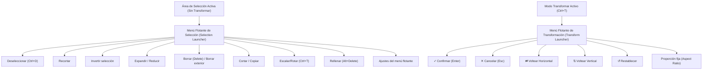

# Estudio de Ingeniería Inversa (REA): Modo de Transformación y Sistema de Selección en Clip Studio Paint (CSP)

Este informe documenta la investigación técnica realizada mediante ingeniería inversa y análisis de artefactos del software **Clip Studio Paint** (CELSYS, versión 1.5.x - 3.x para Windows x64).

---

## 1. Fuentes de Evidencia Analizadas

| Artefacto / Archivo | Tipo | Hallazgos clave |
|---|---|---|
| `CLIPStudioPaint.exe` | Binario PE64 | Controlador principal de UI (`PWView`, `PWPushButton`, etc.) y dispatch de comandos. |
| `iswCoreTG.dll` | Biblioteca nativa DLL | Exporta primitivas matemáticas y transformaciones de raster: `TransformEquation`, `Transform3Work`, `TransformStructure`, `TransformTargetLayer`, `TransformPointEx`, `SelectObject`. |
| `resource\spanish\742DEA58-ED6B-4402-BC11-20DFC6D08040` | Bundle de recursos Celsys (ES) | Nomenclatura oficial: `Menú flotante de selección`, `Menú flotante de transformación`, modos de transformación (`Escalar/Rotar`, `Transformación libre`, `Transformación de malla`). |
| `Settings\PAINT\Tool\english\EditImageTool.todb` | Base de datos SQLite | Esquemas de herramientas: parámetros `SelectCreateType`, `SelectMoveImage`, `LayerMoveInSelectArea`, `LayerMoveRemainOriginal`. |
| `Settings\PAINT\Tool\english\DefaultToolModifyKey.tomd` | Base de datos SQLite | Configuración de teclas modificadoras (Shift, Alt, Ctrl) para selección y transformación. |
| `Settings\PAINT\WorkSpace\Win\spanish\presetWin_1.spws` | Base de datos SQLite | Configuración y orden de comandos en barras de herramientas y menús flotantes. |

---

## 2. Bloqueo Modal de la Aplicación durante la Transformación

### 2.1 Estado de Operación Exclusiva (Modal Interaction)
En CSP, al activar cualquier transformación (<kbd>Ctrl</kbd> + <kbd>T</kbd> para Escalar/Rotar, o <kbd>Ctrl</kbd> + <kbd>Shift</kbd> + <kbd>T</kbd> para Transformación Libre):
1. **Captura de Entrada**: El controlador de interacción del lienzo (`PWTransformWork`) toma captura exclusiva de los eventos del ratón/lápiz (`PointerCapture`).
2. **Desactivación del Motor de Trazos**: Las herramientas de dibujo (plumas, pinceles, borradores, botes de relleno) se bloquean por completo; los clics sobre el lienzo no emiten stamps ni modifican las texturas de capas.
3. **Bloqueo del Gestor de Capas**:
   - No se permite crear nuevas capas, eliminar capas, cambiar el orden de capas ni alterar su opacidad/modo de fusión mientras dure la transformación.
   - Si el usuario hace clic en una capa diferente, CSP muestra un diálogo o fuerza a confirmar (<kbd>Enter</kbd>) o cancelar (<kbd>Esc</kbd>) la transformación antes de cambiar de capa.
4. **Bloqueo de Animación y Timeline**:
   - El cabezal de tiempo (scrubber) y los botones de reproducción de la línea de tiempo se deshabilitan.
   - Cambiar de fotograma o reproducir requiere confirmar la transformación en curso para evitar estados de dibujo duplicados o artefactos "fantasma".
5. **Menús Principales Inactivos**:
   - Los menús como `Filtro`, `Capa`, `Selección`, `Edición` (excepto Deshacer/Rehacer la propia operación de transformación) se muestran en estado deshabilitado (gris).
   - Solo se permiten operaciones de navegación del lienzo (`Zoom`, `Pan`, `Rotar lienzo`, `Navegador`).

### 2.2 Salida del Estado Modal
Para salir del modo de transformación, CSP ofrece únicamente dos vías:
- **Confirmar (`OK` / `✓` / <kbd>Enter</kbd> / Doble Clic)**: Rasteriza el búfer transformado sobre la capa activa (o corta y pega los píxeles si había selección) y aplica la misma matriz matemática a la máscara de selección si `SelectMoveImage` estaba activo.
- **Cancelar (`Cancel` / `✕` / <kbd>Esc</kbd>)**: Descarta el búfer flotante temporal y restaura los píxeles originales de la capa sin registrar cambios en el historial destructivo.

---

## 3. UI en el Límite Máximo Y de la Selección (Menús Flotantes / Launchers)

Clip Studio Paint distingue **dos tipos diferentes de barras flotantes HUD** que se colocan adyacentes a la selección:

### 3.1 Posicionamiento en el Y Máximo (`Y_max`)
El cálculo de coordenadas en pantalla del lanzador sigue esta lógica en CSP:
1. **Punto Ancla Horizontal**: Centro del cuadro delimitador (`(bbox.minX + bbox.maxX) / 2`).
2. **Punto Ancla Vertical**: Directamente debajo de la selección (`bbox.maxY + margin_px`).
3. **Algoritmo Anti-Desbordamiento (Viewport Clamping & Flipping)**:
   - Si `y_bottom + launcher_height > viewport_height`, el menú flotante se invierte automáticamente (`flip`) y se coloca **arriba de la selección**: `bbox.minY - launcher_height - margin_px`.
   - Si la selección ocupa toda la pantalla (por ejemplo, <kbd>Ctrl</kbd> + <kbd>A</kbd>), el lanzador se ancla al borde inferior interior del visor con un margen de seguridad, asegurando que nunca quede oculto fuera de los límites de la ventana.

---

## 4. Capacidad de Mover la Selección (Mover Carpa vs Mover Píxeles)

La base de datos `EditImageTool.todb` y el análisis de `iswCoreTG.dll` revelan dos mecanismos ortogonales:

### 4.1 Mover Únicamente la Carpa de Selección (`SelectMoveImage = 0`)
- **Herramienta activa**: Cualquier herramienta de selección (Rectángulo, Elipse, Lazo, Polilínea).
- **Comportamiento**:
  - Si el usuario hace clic y arrastra **dentro** del área seleccionada (o con la opción de mover selección activada), el cursor cambia a una flecha con marco punteado.
  - El arrastre desplaza **únicamente las coordenadas de la máscara / carpa de selección (marching ants)**.
  - Los píxeles del dibujo **no sufren ninguna modificación**.
  - **Atajo con flechas de teclado**: Al presionar <kbd>↑</kbd>, <kbd>↓</kbd>, <kbd>←</kbd>, <kbd>→</kbd> teniendo una herramienta de selección activa, la máscara se desplaza 1 píxel (o 10 píxeles si se mantiene presionado <kbd>Shift</kbd>).

### 4.2 Mover el Contenido / Píxeles (`LayerMoveInSelectArea = 1`)
- **Herramienta activa**: Herramienta **Mover capa** (`Move layer`, atajo <kbd>K</kbd>) o entrada en **Transformación** (<kbd>Ctrl</kbd> + <kbd>T</kbd>).
- **Comportamiento**:
  - Si no hay selección activa, mueve la capa completa.
  - Si **hay selección activa**, el motor aísla los píxeles dentro de la máscara de selección en un búfer flotante temporal y desplaza únicamente esos píxeles.
  - **Duplicación con Alt (`LayerMoveRemainOriginal = 1`)**: Si se mantiene presionada la tecla <kbd>Alt</kbd> mientras se inicia el arrastre, los píxeles originales permanecen intactos en la capa y se crea una copia flotante que se desplaza junto con la selección.

---

## 5. Resumen de Recomendaciones para Oniri

1. **Modo Modal de Transformación**:
   - Mantener el bloqueo estricto en la UI para que herramientas de dibujo, cambios de capa y scrubbing de animación no puedan ejecutarse sin confirmar o cancelar el gizmo previamente.
2. **Separación de Menús Flotantes**:
   - Implementar el **Menú flotante de selección** (con botones para deseleccionar, invertir, borrar, rellenar y activar transformación) cuando hay selección estática.
   - Mostrar el **Menú flotante de transformación** (con `✓`, `✕`, voltear horizontal/vertical) únicamente cuando el gizmo de transformación esté activo.
3. **Mover Selección con Herramienta de Selección**:
   - Permitir que, al tener la herramienta Selección activa, arrastrar desde dentro de la selección desplace solo la máscara sin modificar el dibujo.
