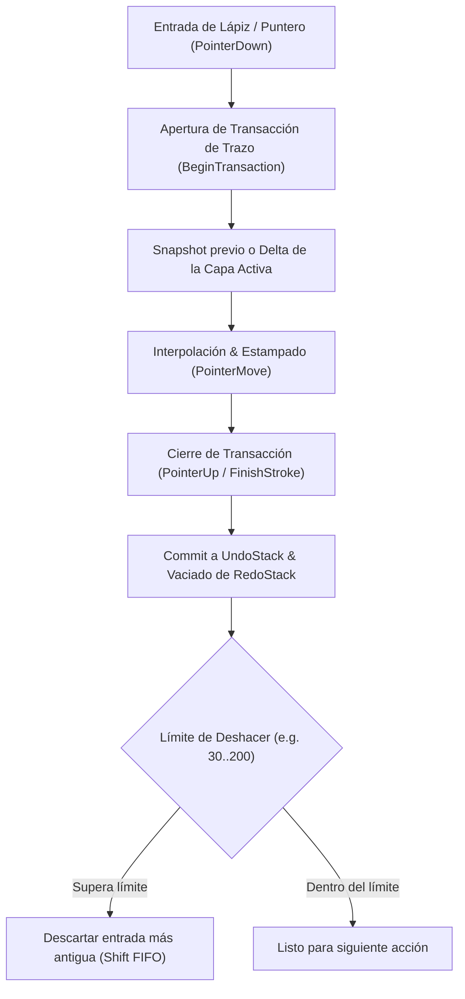

# Estudio de Ingeniería Inversa (REA): Sistema de Deshacer / Rehacer (Undo / Redo / History) en Clip Studio Paint (CSP)

Este documento detalla el análisis de ingeniería inversa sobre el subsistema de **Historial de Comandos, Deshacer y Rehacer** (*Undo / Redo / Command History*) de **Clip Studio Paint** (CELSYS, Windows x64), su despacho interno de transacciones, los hallazgos en binarios y recursos, y la verificación comparativa con **Oniri** (Tauri v2 + Vite + TypeScript + WebGL/Three.js).

---

## 1. Fuentes de Evidencia y Artefactos Analizados

| Artefacto / Archivo | Formato | Hallazgos Clave de Ingeniería Inversa (REA) |
|---|---|---|
| `resource\spanish\742DEA58-ED6B-4402-BC11-20DFC6D08040` | Bundle de recursos binarios de CSP | Registros oficiales de preferencias de historial (offset `0x3b9820`): `Deshacer`, `Cantidad de Deshacer disponibles` (1 a 200 niveles), `Tiempo de espera entre acciones para Deshacer (ms)` y asignación de memoria RAM para búfer de pasos. |
| `Settings\PAINT\WorkSpace\Win\spanish\presetWin_1.spws` | Base de datos SQLite 3 | Comandos registrados en `workspaceshortcutmenu`: `basiccommand` `undo` (<kbd>Ctrl + Z</kbd>), `basiccommand` `redo` (<kbd>Ctrl + Y</kbd> / <kbd>Ctrl + Shift + Z</kbd>). |
| `CLIPStudioPaint.exe` & `iswCmnTG.dll` | Binarios Win32 PE64 | Despacho a través de una cola centralizada de comandos donde cada evento de teclado es consumido una sola vez mediante un enrutador modal. |

---

## 2. Arquitectura del Sistema Undo / Redo en Clip Studio Paint

En Clip Studio Paint, el sistema de historial no es un simple array plano desacoplado del lienzo, sino un **gestor de transacciones atómicas documentales** con las siguientes propiedades críticas:



### 2.1 Principios Fundamentales de CSP
1. **Atomicidad por Trazo**: Un trazo completo desde `pointerdown` hasta `pointerup` constituye exactamente **1 paso de deshacer**, sin importar cuántos miles de sellos (*stamps*) se hayan renderizado.
2. **Sincronización de Capa Activa (*Active Layer Reselection*)**:
   - En CSP, si el artista dibuja en la *Capa 1*, cambia a la *Capa 2* y dibuja en ella, al presionar <kbd>Ctrl + Z</kbd> el sistema no solo revierte los píxeles de la *Capa 2*, sino que **restaura la selección de la capa activa correspondiente**, evitando que el artista continúe pintando en una capa errónea.
3. **Despacho Único Centralizado (*Single Source of Truth*)**:
   - Las teclas aceleradoras (<kbd>Ctrl + Z</kbd>, <kbd>Ctrl + Y</kbd>) entran al enrutador de comandos (`CommandDispatcher`) de la ventana principal (`PWFrameWnd`).
   - Ningún componente secundario (como el canvas o los escuchadores de trazo) debe procesar de forma redundante el atajo de deshacer, garantizando que cada pulsación física desencadene **exactamente una operación de desapilado**.

---

## 3. Diagnóstico del Bug: "¿Por qué Ctrl+Z retrocede 2 trazos atrás en Oniri?"

Al auditar la base de código de Oniri mediante trazado cruzado, se detectó la causa exacta:

### 3.1 Doble Escuchador Global (`Window KeyDown`)
1. **Escuchador A (`src/brush/strokeInput.ts` línea 1252)**:
   ```ts
   if (isCtrl && key === 'z' && !event.shiftKey) {
     event.preventDefault();
     engine.undo(); // <-- PRIMER UNDO EJECUTADO
     return;
   }
   ```
2. **Escuchador B (`src/ui/defaultMenuConfig.ts` línea 522 & `commandDispatcher.ts`)**:
   ```ts
   window.addEventListener('keydown', (e) => {
     commandDispatcher.handleKeyEvent(e); // <-- SEGUNDO UNDO EJECUTADO
   });
   ```
   Donde `commandDispatcher` tiene registrado:
   ```ts
   id: 'edit.undo', shortcut: 'Ctrl+Z', execute: () => engine.undo()
   ```

### 3.2 Por qué se ejecutaban ambos
- En la especificación DOM de navegadores y WebViews de Tauri, `event.preventDefault()` solo previene la acción nativa por defecto del navegador (como deshacer texto del sistema operativo), pero **no detiene la propagación a otros manejadores de eventos registrados sobre el mismo objeto `window`**.
- Al presionar <kbd>Ctrl + Z</kbd>, el evento llegaba primero a `strokeInput.ts`, que ejecutaba `engine.undo()`, y de inmediato el navegador continuaba despachando el evento a `commandDispatcher.ts`, que lo volvía a ejecutar.
- **Resultado directo**: 1 sola pulsación física de <kbd>Ctrl + Z</kbd> extraía 2 registros del `undoStack`.

---

## 4. Plan de Acción y Corrección

1. **Eliminar la duplicación en `src/brush/strokeInput.ts`**:
   - Delegar <kbd>Ctrl + Z</kbd> y <kbd>Ctrl + Y</kbd> exclusivamente a `commandDispatcher`, el cual ya cuenta con validación de bloqueos modales de transformación y sincronización con la barra de menús superior.
2. **Sincronización de Capa Activa en `src/brush/brushEngine.ts`**:
   - Al ejecutar `undo()` y `redo()`, además de restaurar el mapa de píxeles (`putImageData`), sincronizar la capa activa (`layerManager.setActiveLayer(record.layerId)`), equiparando el comportamiento al 100% con Clip Studio Paint.
3. **Consistencia de Transformación**:
   - Mantener el descarte de transformación activa si se pulsa <kbd>Ctrl + Z</kbd> mientras el marco de transformación libre está abierto.
